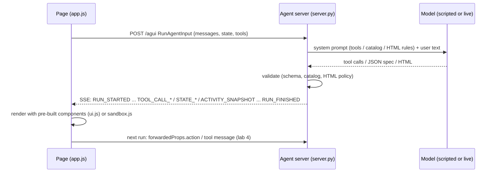

# Part 1 - AG-UI: the event stream between agent and page

**AG-UI** (Agent-User Interaction protocol) is a *transport*. It does not say what a UI looks like. It defines ~20 typed events an agent backend streams to a frontend over HTTP + Server-Sent Events: run lifecycle, text messages, tool calls, shared state (snapshot + JSON Patch deltas) and activities. The frontend answers by starting the next run with a `RunAgentInput` (messages, state, the tools the page offers, forwarded props).

That makes AG-UI the natural carrier for **all four generation modes**, which is why this course starts here:

| Lab | Mode | What the agent emits | AG-UI events used |
|---|---|---|---|
| [lab1_static](lab1_static/) | static | tool calls that pick pre-built components | `TOOL_CALL_START/ARGS/END` |
| [lab2_declarative](lab2_declarative/) | declarative | a catalog layout (flat element map) | `STATE_SNAPSHOT`, `STATE_DELTA` (RFC 6902), `STEP_*` |
| [lab3_open_ended](lab3_open_ended/) | open-ended | a whole HTML/CSS/JS document | `TEXT_MESSAGE_*`, `ACTIVITY_SNAPSHOT` |
| [lab4_mixed](lab4_mixed/) | mixed | catalog layout + one sandboxed `GeneratedView`; user actions loop back | all of the above + client tools, tool messages |

**Libraries used:** the official Python SDK `ag-ui-protocol` (`ag_ui.core` event models and `RunAgentInput`, `ag_ui.encoder.EventEncoder`). The browser client (`common/web/agui.js`, 15 lines) is hand-written on purpose, to show the wire format; `@ag-ui/client`'s `HttpAgent` does the same job in production.

**Run any lab:** `cd 01_ag_ui/labN_xxx && python server.py`, then open the printed URL. `python demo.py` records the run; `python -m pytest test_lab.py` runs the offline tests.

Video script for this part: [docs/video-scripts/part1_ag_ui.md](../docs/video-scripts/part1_ag_ui.md).
