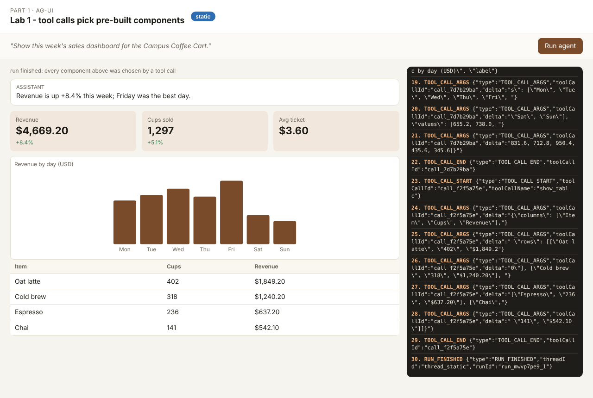
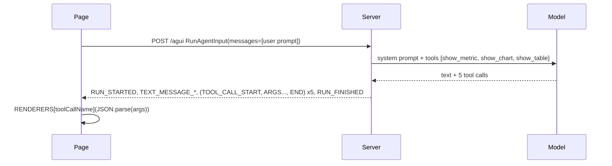

# Part 1 · Lab 1 - AG-UI, static mode: tool calls pick pre-built components

**What this lab adds:** the smallest useful generative UI. Three components exist in the page ahead of time (metric card, bar chart, table). The agent never designs anything: it *selects* a component by calling a tool such as `show_metric(label, value, delta)` and *fills* its props. AG-UI streams each tool call as `TOOL_CALL_START` → `TOOL_CALL_ARGS` (JSON text in chunks) → `TOOL_CALL_END`, and the page maps the tool name to its renderer.

## Run it

```bash
cd 01_ag_ui/lab1_static
python server.py              # open http://127.0.0.1:8011
python demo.py                # recorded run: event stream + screenshot
python -m pytest test_lab.py  # offline tests
```

## Recorded run

<!-- demo-output:start -->
```text
$ python demo.py
========================================================================
Part 1 / Lab 1 - AG-UI, static mode: tool calls select pre-built components
========================================================================
POST /agui -> 30 AG-UI events over SSE
  {"type":"RUN_STARTED","threadId":"demo","runId":"run_39001"}
  {"type":"TEXT_MESSAGE_START","messageId":"msg_8e63229d","role":"assistant"}
  {"type":"TEXT_MESSAGE_CONTENT","messageId":"msg_8e63229d","delta":"Revenue is up +8.4% this week; Friday wa...
  {"type":"TEXT_MESSAGE_END","messageId":"msg_8e63229d"}
  {"type":"TOOL_CALL_START","toolCallId":"call_29166414","toolCallName":"show_metric"}
  {"type":"TOOL_CALL_ARGS","toolCallId":"call_29166414","delta":"{\"label\": \"Revenue\", \"value\": \"$4,669...
  {"type":"TOOL_CALL_ARGS","toolCallId":"call_29166414","delta":"\", \"delta\": \"+8.4%\"}"}
  {"type":"TOOL_CALL_END","toolCallId":"call_29166414"}
  {"type":"TOOL_CALL_START","toolCallId":"call_f7df32ca","toolCallName":"show_metric"}
  ...
  {"type":"RUN_FINISHED","threadId":"demo","runId":"run_39001"}
event counts: {'RUN_STARTED': 1, 'TEXT_MESSAGE_START': 1, 'TEXT_MESSAGE_CONTENT': 1, 'TEXT_MESSAGE_END': 1, 'TOOL_CALL_START': 5, 'TOOL_CALL_ARGS': 15, 'TOOL_CALL_END': 5, 'RUN_FINISHED': 1}
components chosen by the agent: ['show_metric', 'show_metric', 'show_metric', 'show_chart', 'show_table']
screenshot: screenshot.png
```
<!-- demo-output:end -->



## How it works



## Code walkthrough

**Step 1 - offer the pre-built components as tools.** Each component becomes a function-calling schema. The model can only choose among these three.

`server.py`:
```python
TOOLS = [
    {"name": "show_metric", "description": "Show one key number on a metric card.",
     "parameters": {"type": "object", "required": ["label", "value"], "properties": {
         "label": {"type": "string"}, "value": {"type": "string"}, "delta": {"type": "string"}}}},
...
]
```

**Step 2 - check every call before it leaves the server.** The page must never receive a component it cannot draw.

`server.py`:
```python
def check_args(name: str, args: dict) -> list[str]:
    """The page must never receive a component it cannot draw: check before sending."""
    if name not in TOOL_NAMES:
        return [f"unknown tool {name}"]
    schema = next(t for t in TOOLS if t["name"] == name)["parameters"]
    return [f"{name}: missing {p}" for p in schema["required"] if p not in args]
```

**Step 3 - turn the model's reply into AG-UI events.** A run is a Python generator of event objects from the official SDK. Arguments are streamed in 40-character slices, the way a model streams them.

`server.py`:
```python
    for call in reply["tool_calls"]:
        if check_args(call["name"], call["arguments"]):
            continue  # drop anything the page cannot render
        yield ToolCallStartEvent(type=EventType.TOOL_CALL_START, tool_call_id=call["id"], tool_call_name=call["name"])
        args = json.dumps(call["arguments"])
        for i in range(0, len(args), 40):  # arguments stream as JSON text, like a model streams them
            yield ToolCallArgsEvent(type=EventType.TOOL_CALL_ARGS, tool_call_id=call["id"], delta=args[i:i + 40])
        yield ToolCallEndEvent(type=EventType.TOOL_CALL_END, tool_call_id=call["id"])
```

**Step 4 - encode as SSE.** `RunAgentInput` validates the request; `EventEncoder` produces `data: {...}\n\n` frames.

`server.py`:
```python
    @app.post("/agui")
    def agui(req):
        inp = RunAgentInput.model_validate(req.json())  # the official input schema
        return SSE(encoder.encode(e) for e in run(inp))
```

**Step 5 - the page: one renderer per tool.** This table *is* static generative UI. Adding a component means adding code here.

`page/app.js`:
```js
const RENDERERS = {
  show_metric: (a) => components.Metric(a),
  show_chart: (a) => components.BarChart(a),
  show_table: (a) => components.Table(a),
};
```

**Step 6 - handle the events.** A placeholder appears at `TOOL_CALL_START`, arguments accumulate, the component is drawn at `TOOL_CALL_END`.

`page/app.js`:
```js
      case "TOOL_CALL_ARGS": pending[ev.toolCallId].args += ev.delta; break;
      case "TOOL_CALL_END": {                          // arguments complete: draw the component
        const call = pending[ev.toolCallId];
        const render = RENDERERS[call.name];
        call.slot.replaceWith(render ? render(JSON.parse(call.args)) : h("div", { class: "g-error" }, `no renderer for ${call.name}`));
```

## What to notice

- The model controls **which** components and **what** data, never **how** they look. Output is tiny (see the token table in lab 3) and fully predictable.
- The limit is also clear: a request for something without a tool (a calculator, a map) cannot be answered with UI.
- The right-hand "wire" panel shows every AG-UI event the page received, in order.

## Tests (`test_lab.py`)

Run bracketing (`RUN_STARTED` … `RUN_FINISHED`), every tool call is known and its streamed arguments parse to JSON, invalid calls are dropped server-side, the input validates against the official `RunAgentInput` schema, and the prompt carries the data and the tool list.

**Try it:** add a `show_badge(text, tone)` tool: one schema in `TOOLS`, one entry in `RENDERERS`, one call in `fixtures/dashboard.json`.
