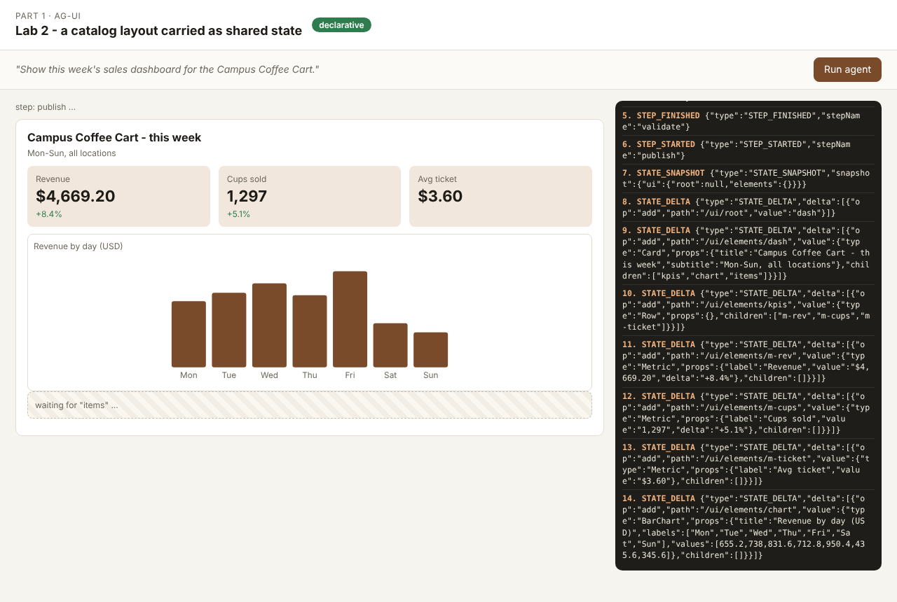
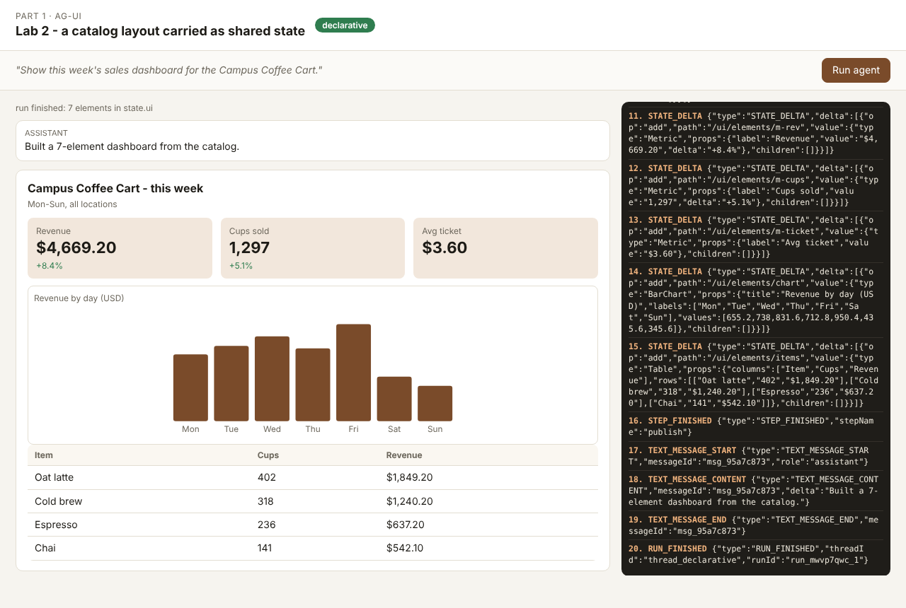

# Part 1 · Lab 2 - AG-UI, declarative mode: the UI is shared state

**What this lab adds:** the agent now designs the *layout*, not just the data, but only from a catalog of allowed components (`Card`, `Row`, `Column`, `Text`, `Metric`, `BarChart`, `Table`, `Button`). It writes a **flat element map**; the server validates it against the catalog; then it publishes the layout as **AG-UI shared state**: one `STATE_SNAPSHOT` (an empty canvas) followed by one `STATE_DELTA` (RFC 6902 JSON Patch) per element, parent first. The page applies each patch and repaints, so the frame appears before the details.

## Run it

```bash
cd 01_ag_ui/lab2_declarative
python server.py              # open http://127.0.0.1:8012
python demo.py
python -m pytest test_lab.py
```

## Recorded run

<!-- demo-output:start -->
```text
$ python demo.py
========================================================================
Part 1 / Lab 2 - AG-UI, declarative mode: the UI is shared state
========================================================================
system prompt (generated from the catalog), first lines:
  | You build user interfaces from a fixed component catalog.
  | Reply with ONE JSON object: {"root": "<id>", "elements": {"<id>": {"type", "props", "children"}}
  | children is a list of element ids (an empty list when none). Use only these components:
  | - Card(title: string, subtitle?: string) - A titled container. Children go inside.
  | - Row() - Lays children out side by side.
  | - Column() - Stacks children vertically.
POST /agui -> 20 events
  {"type":"STEP_STARTED","stepName":"generate"}
  {"type":"STEP_STARTED","stepName":"validate"}
  {"type":"STEP_STARTED","stepName":"publish"}
  {"type":"STATE_SNAPSHOT","snapshot":{"ui":{"root":null,"elements":{}}}}
  {"type":"STATE_DELTA","delta":[{"op":"add","path":"/ui/root","value":"dash"}]}
  {"type":"STATE_DELTA","delta":[{"op":"add","path":"/ui/elements/dash","value":{"type":"Card","props":{"title":"Campus...
  {"type":"STATE_DELTA","delta":[{"op":"add","path":"/ui/elements/kpis","value":{"type":"Row","props":{},"children":["m...
8 STATE_DELTA events rebuilt state.ui with 7 elements: dash:Card, kpis:Row, m-rev:Metric, m-cups:Metric, m-ticket:Metric, chart:BarChart, items:Table
screenshot: screenshot_partial.png
screenshot: screenshot.png
```
<!-- demo-output:end -->

Mid-stream (the card and metrics are in state; the table is still a skeleton) and finished:




## Why a flat element map?

```json
{"root": "dash",
 "elements": {
   "dash":  {"type": "Card",   "props": {"title": "..."}, "children": ["kpis", "chart", "items"]},
   "kpis":  {"type": "Row",    "props": {}, "children": ["m-rev", "m-cups", "m-ticket"]},
   "m-rev": {"type": "Metric", "props": {"label": "Revenue", "value": "$4,669.20"}, "children": []}}}
```

Every element has an id and children are referenced by id. A parent can be rendered while a child is still missing (it becomes a skeleton), and each element is an independent JSON Patch `add`. A nested tree would be unusable until its closing braces arrive. A2UI and json-render use the same idea.

## Code walkthrough

**Step 1 - one catalog, three uses.** `common/catalog.py` defines the components once. The system prompt is generated from it, so the prompt and the validator cannot drift apart.

`server.py`:
```python
SYSTEM = catalog_prompt() + f"\n\nData for the dashboard:\n{scenario.as_text()}\n" \
```

**Step 2 - generate, then validate before anything reaches the page.** A bad layout becomes a `RUN_ERROR` with readable messages.

`server.py`:
```python
    reply = "".join(llm.stream(system=SYSTEM, user=user_text, fixture="dashboard_spec"))
...
    try:
        spec = parse_json_reply(reply)
        errors = validate_spec(spec)
    except ValueError as exc:
        spec, errors = None, [f"reply is not JSON: {exc}"]
...
    if errors:
        yield RunErrorEvent(type=EventType.RUN_ERROR, message="; ".join(errors[:5]), code="INVALID_UI_SPEC")
        return
```

**Step 3 - publish the layout as state: a snapshot, then one delta per element.** `spec_to_patches` orders the operations parent-first.

`server.py`:
```python
    yield StateSnapshotEvent(type=EventType.STATE_SNAPSHOT, snapshot={"ui": {"root": None, "elements": {}}})
    for op in spec_to_patches(spec):
        op = {**op, "path": "/ui" + op["path"]}
...
        yield StateDeltaEvent(type=EventType.STATE_DELTA, delta=[op])
```

**Step 4 - the catalog validator.** Unknown components, missing or mistyped props, unknown props and dangling children are all errors.

`../../common/catalog.py`:
```python
    kind = el.get("type")
    if kind not in cat:
        return [f"{eid}: unknown component {kind!r}; allowed: {', '.join(cat)}"]
```

**Step 5 - the page mirrors the state and repaints.** That is the whole client: a snapshot replaces, a delta patches.

`page/app.js`:
```js
      case "STATE_SNAPSHOT": state = ev.snapshot; paint(); break;           // replace everything
      case "STATE_DELTA": state = applyPatch(state, ev.delta); paint(); break; // patch, then repaint
```

**Step 6 - the renderer walks the element map; a missing child becomes a skeleton.**

`../../common/web/ui.js`:
```js
  const visit = (id) => {
    const el = spec.elements?.[id];
    if (!el) return skeleton(id);
```

## What to notice

- The model now chooses structure (which card holds what, in which order) - but only from names the application owns.
- The STEP events make the pipeline visible: `generate` → `validate` → `publish`.
- State is the contract: any AG-UI client that understands the catalog can render the same run.

## Tests (`test_lab.py`)

The deltas rebuild exactly the generated spec; parents arrive before children; the three steps are reported; an invalid layout (`PieChart`) becomes `RUN_ERROR` with no state change; the prompt lists the catalog.

**Try it:** add a `Badge(text)` component in `common/catalog.py` and `common/web/ui.js`; the prompt updates itself.
