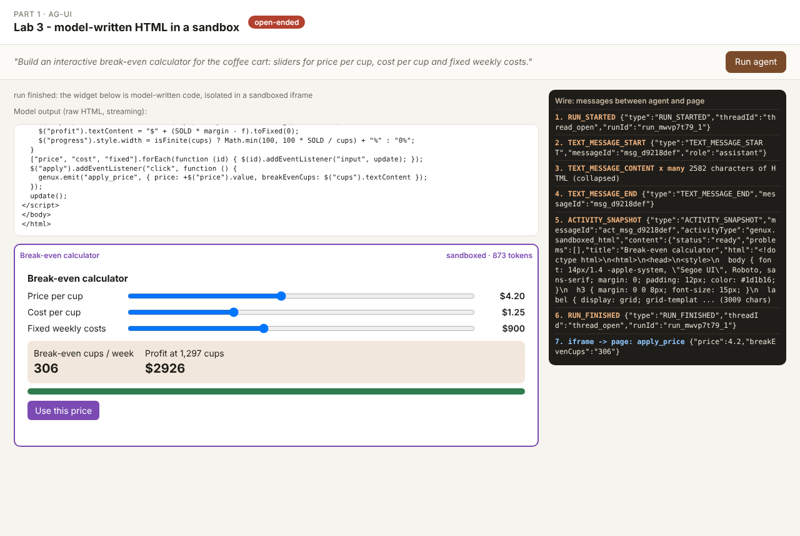

# Part 1 · Lab 3 - AG-UI, open-ended mode: model-written HTML in a sandbox

**What this lab adds:** no catalog at all. The user asks for something no pre-built component covers - an interactive break-even calculator - and the model writes the whole widget as one HTML/CSS/JS document. The HTML streams as an ordinary `TEXT_MESSAGE_*` (the page shows the source growing, but does **not** run it). When it is complete, the server checks it against a policy and sends an `ACTIVITY_SNAPSHOT` (AG-UI's event for non-chat content such as generated UI). Only then does the page mount it - in a sandboxed iframe with a Content-Security-Policy.

## Run it

```bash
cd 01_ag_ui/lab3_open_ended
python server.py              # open http://127.0.0.1:8013
python demo.py                # also moves a slider and clicks inside the sandbox
python -m pytest test_lab.py
```

## Recorded run

<!-- demo-output:start -->
```text
$ python demo.py
========================================================================
Part 1 / Lab 3 - AG-UI, open-ended mode: model-written HTML in a sandbox
========================================================================
POST /agui -> 98 events (93 TEXT_MESSAGE_CONTENT chunks of raw HTML)
  {"type":"TEXT_MESSAGE_CONTENT","messageId":"msg_90b90ee5","delta":"<!doctype html>\n<html>\n<head"}
  ACTIVITY_SNAPSHOT: {"status":"ready","problems":[],"title":"Break-even calculator","tokens":873,"token_method":"o200k_base via gpt-tokenizer","allowedEvents":["apply_price"]}
output tokens (o200k_base via gpt-tokenizer):
  static      (5 tool calls)          263
  declarative (catalog JSON spec)     535
  open-ended  (HTML document)         873   <- one widget, no data table
clicked inside the sandbox -> page received: 7. iframe -> page: apply_price {"price":4.2,"breakEvenCups":"306"}
screenshot: screenshot.png
```
<!-- demo-output:end -->



## The three safety layers

| Layer | Where | What it stops |
|---|---|---|
| `check_html` policy | server, before sending | oversized documents, `<script src>`, external CSS, `fetch`/`XMLHttpRequest`/`WebSocket`, nested frames |
| CSP `<meta>` injected **first** in `<head>` | page, before mounting | any network request, external resource or form post, even if the policy missed it |
| `<iframe sandbox="allow-scripts">` without `allow-same-origin` | page | access to the parent DOM, cookies and storage; the document's only exit is `postMessage` |

The page accepts a message only if it comes from *that* iframe, has the shape `{type: "genux:event", name, payload}`, and `name` is on the allow-list (`apply_price`).

## Code walkthrough

**Step 1 - the prompt defines the contract instead of a catalog.** One way out (`genux.emit`), one accepted event.

`server.py`:
```python
SYSTEM = """You write ONE self-contained HTML document for an interactive widget.
Rules:
- Inline <style> and <script> only. No external scripts, stylesheets, fonts, images or network calls.
- The document runs in a sandbox. To send a result to the app call genux.emit(name, payload).
  The only event the app accepts is "apply_price" with payload {"price": number}.
```

**Step 2 - stream the HTML as text.**

`server.py`:
```python
    for chunk in llm.stream(system=SYSTEM, user=user_text, fixture="break_even"):
        parts.append(chunk)
        yield TextMessageContentEvent(type=EventType.TEXT_MESSAGE_CONTENT, message_id=mid, delta=chunk)
```

**Step 3 - check the finished document, then send it as an activity.**

`server.py`:
```python
    html = strip_fences("".join(parts))
    problems = check_html(html)
    yield ActivitySnapshotEvent(
        type=EventType.ACTIVITY_SNAPSHOT, message_id=f"act_{mid}", activity_type="genux.sandboxed_html",
```

**Step 4 - the policy.**

`../../common/sandbox.py`:
```python
_EXTERNAL = [
    (re.compile(r"<script[^>]+\bsrc\s*=", re.I), "external <script src> is not allowed"),
    (re.compile(r"<link[^>]+\bhref\s*=\s*[\"']?(https?:)?//", re.I), "external stylesheet is not allowed"),
    (re.compile(r"\b(fetch|XMLHttpRequest|WebSocket|EventSource)\s*\(", re.I), "network APIs are not allowed"),
```

**Step 5 - mount: CSP first, then the bridge, in an opaque-origin iframe.**

`../../common/web/sandbox.js`:
```js
  if (/<head[^>]*>/i.test(doc)) doc = doc.replace(/<head[^>]*>/i, (m) => m + meta + BRIDGE);
...
  frame.setAttribute("sandbox", "allow-scripts");
```

**Step 6 - accept exactly one message shape from exactly one frame.**

`../../common/web/sandbox.js`:
```js
    if (e.source !== frame.contentWindow) return; // only this frame
...
    if (d.type !== "genux:event" || typeof d.name !== "string") return; // one accepted shape
    if (allowed && !allowed.includes(d.name)) { onEvent?.("rejected", { name: d.name }); return; }
```

## What to notice

- **Freedom costs tokens.** The demo prints output tokens for the same coffee-cart data: 5 tool calls (static) < a catalog spec (declarative) < one HTML widget (open-ended), and the widget does not even include the data table.
- **Freedom costs trust.** Every line of the generated document is untrusted code; three independent layers contain it. A sandbox reduces capabilities; it does not make arbitrary output "safe" by itself.
- The source is shown while streaming but executed only after the policy verdict.

## Tests (`test_lab.py`)

HTML streams as text and arrives complete in the activity; a document with `<script src>` and `fetch()` is rejected and never sent; the CSP lands before any other head element; the fixture passes the policy.

**Try it:** edit `fixtures/break_even.html` to call `fetch("https://example.com")` and re-run: the page shows "rejected by policy".
