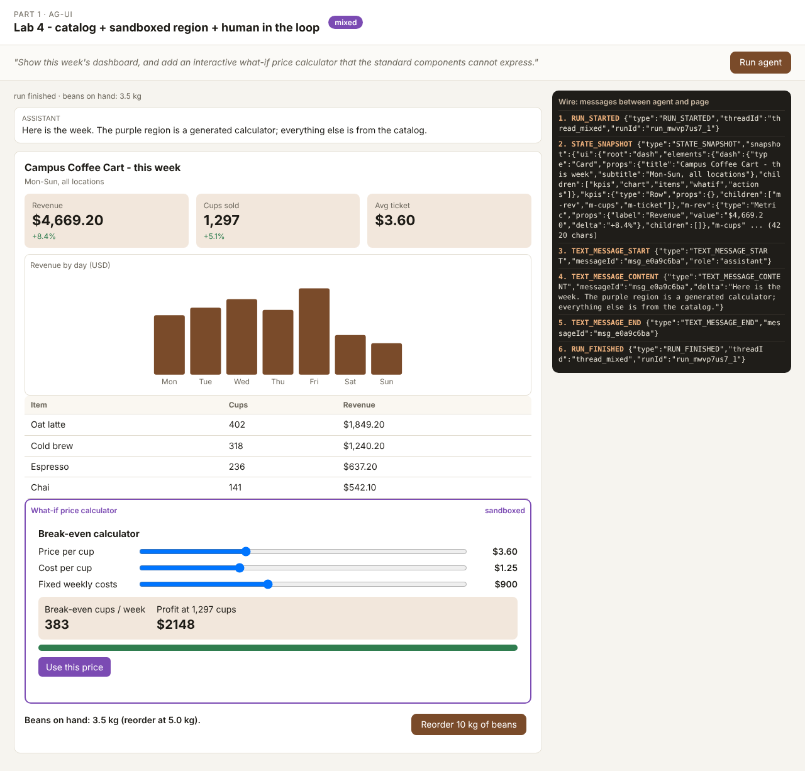
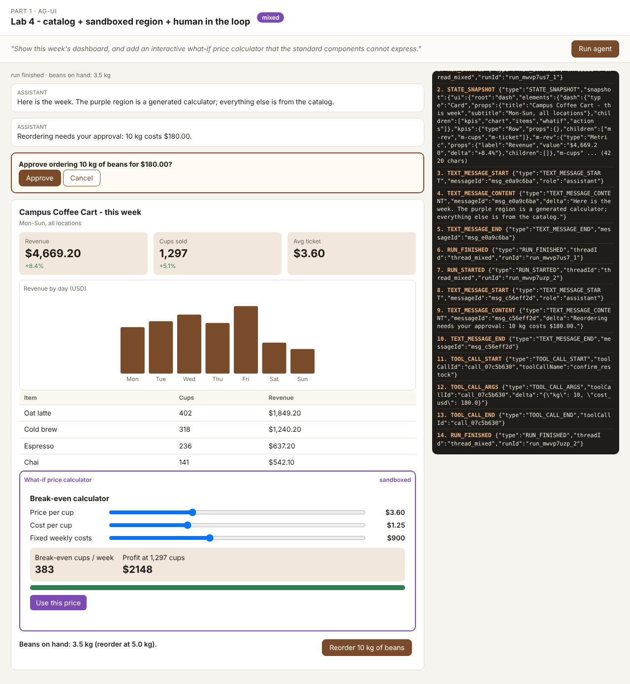
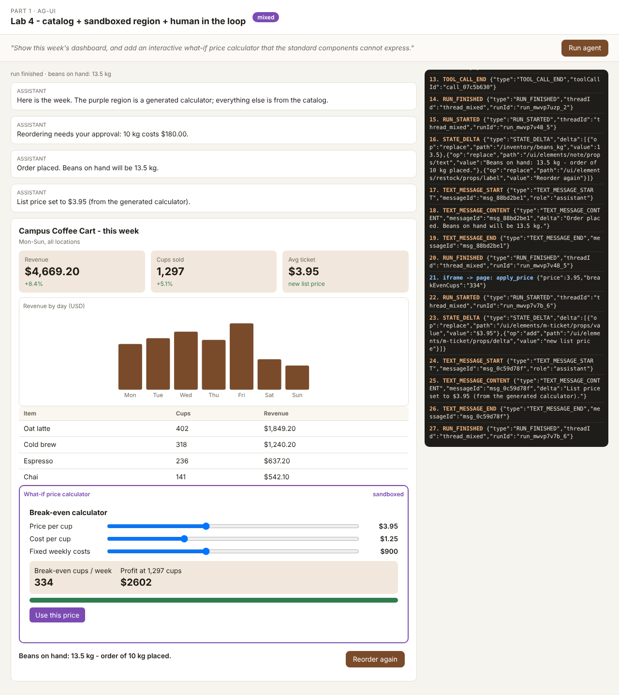

# Part 1 · Lab 4 - AG-UI, mixed mode: catalog + one sandboxed region + human in the loop

**What this lab adds:** the hybrid most production systems should default to. The layout comes from the catalog (lab 2) and the catalog gains exactly one escape hatch, `GeneratedView`, whose `html` prop is model-written and runs in the lab-3 sandbox. Then the loop closes: user interaction goes back to the agent as new AG-UI runs, in three different ways.

| Round trip | Trigger | How it reaches the agent | Agent's answer |
|---|---|---|---|
| Catalog action | "Reorder 10 kg of beans" `Button` | `forwardedProps.action = "restock_beans"` | calls the page's tool `confirm_restock` |
| Client tool (human in the loop) | Approve / Cancel dialog in the page | a `role: "tool"` message in the next run | `STATE_DELTA` on `/inventory` and the note |
| Sandbox event | "Use this price" inside the iframe → `genux.emit("apply_price")` | forwarded as an action | validates the number, then `STATE_DELTA` on the metric |

The server is **stateless**: the page sends its copy of the state with every run (`RunAgentInput.state`), which is how AG-UI intends shared state to work.

## Run it

```bash
cd 01_ag_ui/lab4_mixed
python server.py              # open http://127.0.0.1:8014
python demo.py                # five runs over HTTP, then the same flow clicked in a browser
python -m pytest test_lab.py
```

## Recorded run

<!-- demo-output:start -->
```text
$ python demo.py
========================================================================
Part 1 / Lab 4 - AG-UI, mixed mode: catalog + sandboxed region + human in the loop
========================================================================
run 1 (request)      -> ['RUN_STARTED', 'STATE_SNAPSHOT', 'TEXT_MESSAGE_START', 'TEXT_MESSAGE_CONTENT', 'TEXT_MESSAGE_END', 'RUN_FINISHED']
   state.ui elements: dash:Card, kpis:Row, m-rev:Metric, m-cups:Metric, m-ticket:Metric, chart:BarChart, items:Table, actions:Row, note:Text, restock:Button, whatif:GeneratedView
run 2 (Button action)-> ['RUN_STARTED', 'TOOL_CALL_START', 'TOOL_CALL_ARGS', 'TOOL_CALL_END', 'RUN_FINISHED']
   agent calls the PAGE's tool confirm_restock({'kg': 10, 'cost_usd': 180.0})
run 3 (tool result)  -> {"type":"STATE_DELTA","delta":[{"op":"replace","path":"/inventory/beans_kg","value":13.5},{"op":"replace","path":"/ui/elements/note/props...
run 4 (sandbox event)-> {"type":"STATE_DELTA","delta":[{"op":"replace","path":"/ui/elements/m-ticket/props/value","value":"$3.95"},{"op":"add","path":"/ui/elemen...
run 5 (unknown action)-> {"type":"RUN_ERROR","message":"action 'delete_database' is not allowed","code":"BAD_ACTION"}
screenshot: screenshot.png
screenshot: screenshot_confirm.png
screenshot: screenshot_after_actions.png
```
<!-- demo-output:end -->

| First render | The agent asks the page to confirm | After approval + a price from the sandbox |
|---|---|---|
|  |  |  |

## Code walkthrough

**Step 1 - the hybrid catalog.** `catalog_prompt(hybrid=True)` adds `GeneratedView` and the list of allowed Button actions; validation checks both the catalog and the HTML policy for the generated region.

`server.py`:
```python
    spec = parse_json_reply(llm.text(system=SYSTEM, user=user_text, fixture="dashboard_hybrid"))
    errors = validate_spec(spec, hybrid=True, actions=set(ACTIONS))
    for eid, el in spec["elements"].items():
        if el["type"] == "GeneratedView":
            errors += [f"{eid}: {p}" for p in check_html(el["props"]["html"])]
```

**Step 2 - route each run.** A run is a new request, a UI action, or the answer to a client tool. Anything else is refused.

`server.py`:
```python
    if fp.get("action") == "restock_beans":
        yield from ask_confirmation(inp, fp.get("params") or {})
    elif fp.get("action") in GENERATED_EVENTS:
        yield from apply_price(fp.get("params") or {})
    elif fp.get("action"):
        yield RunErrorEvent(type=EventType.RUN_ERROR, message=f"action {fp['action']!r} is not allowed", code="BAD_ACTION")
    elif last is not None and last.role == "tool":
        yield from finish_restock(inp, last)
```

**Step 3 - the page offers a tool; the agent calls it.** `confirm_restock` is declared in `RunAgentInput.tools` by the page. The agent streams a normal tool call and ends the run; the page executes it.

`page/app.js`:
```js
const TOOLS = [{
  name: "confirm_restock",
  description: "Ask the user to approve a coffee-bean order. Returns {approved: boolean}.",
```

`page/app.js`:
```js
    messages.push({ id: newId("msg"), role: "tool", toolCallId: callId, content: JSON.stringify({ approved }) });
    send({});
```

**Step 4 - the agent acts on the human's answer with a state delta.**

`server.py`:
```python
    yield StateDeltaEvent(type=EventType.STATE_DELTA, delta=[
        {"op": "replace", "path": "/inventory/beans_kg", "value": beans},
```

**Step 5 - events from the sandbox are untrusted input.**

`server.py`:
```python
    price = params.get("price")
    if not isinstance(price, (int, float)) or not 2 <= price <= 7:
        yield from say("Ignored an invalid price from the calculator.")
        return
```

**Step 6 - repaint only what changed, so the iframe keeps its state.** Re-creating the whole tree would reload the sandboxed calculator and lose the user's slider positions.

`page/app.js`:
```js
function paintChanged(delta) {
  const ids = new Set(delta.map((op) => op.path.split("/")[3]).filter(Boolean));
```

## What to notice

- The catalog keeps 10 of 11 elements predictable, cheap and on-brand; only the calculator pays the open-ended cost.
- A button click never executes anything directly: it names an action, and the **server** decides (allow-list, parameter checks, human confirmation).
- `RUN_ERROR` ends a run; the server never follows it with `RUN_FINISHED` (see `run()`).

## Tests (`test_lab.py`)

Exactly one `GeneratedView`; a Button action yields a client-tool call and no state change; an approved tool result patches inventory to 13.5 kg; a rejected one changes nothing; a non-numeric price from the sandbox is ignored; unknown actions end with `RUN_ERROR` and no `RUN_FINISHED`.
