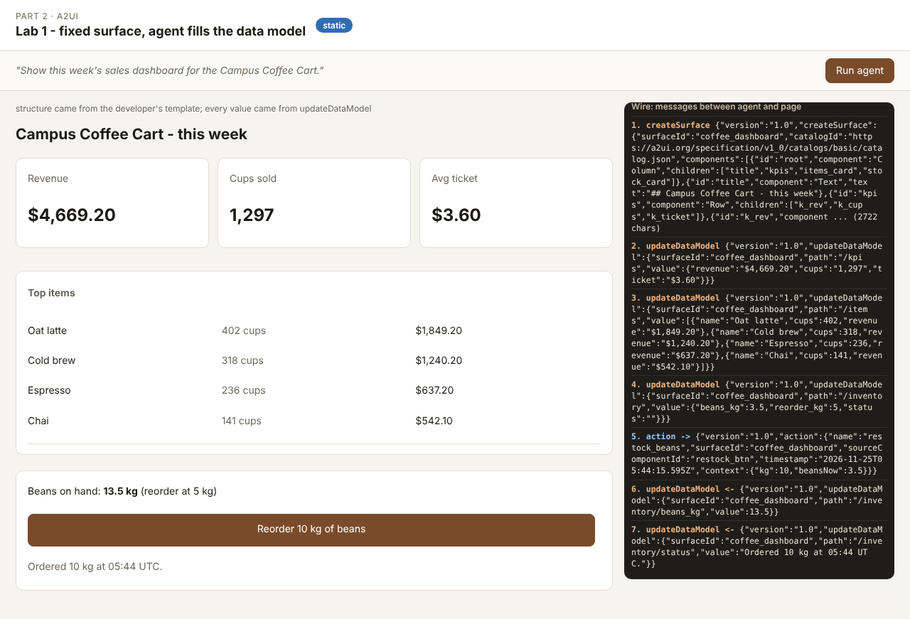

# Part 2 · Lab 1 - A2UI, static mode: fixed surface, agent fills the data model

**What this lab adds:** A2UI's central idea - *structure and data are separate streams* - used for static generative UI. The developer writes the surface once (29 Basic-Catalog components whose values are bindings like `{"@path": "/kpis/revenue"}`). The agent never sends a component. It calls one function, `fill_dashboard(kpis, items, inventory)`, and the server turns its arguments into `updateDataModel` messages. A click on "Reorder" returns as a standard A2UI `action` message and is answered with more data.

## Run it

```bash
npm install                   # once, in the repository root (enables the official @a2ui/web_core check)
cd 02_a2ui/lab1_static
python server.py              # http://127.0.0.1:8021
python demo.py
python -m pytest test_lab.py
```

## Recorded run

<!-- demo-output:start -->
```text
$ python demo.py
========================================================================
Part 2 / Lab 2.1 - A2UI static: developer-written surface, agent-written data
========================================================================
createSurface: 29 components from the developer template, e.g.
    {"id":"k_rev_label","component":"Text","text":"Revenue","variant":"caption"}
    {"id":"k_rev_value","component":"Text","text":{"@call":"formatString","args":{"value":"### ${/kpis/revenue}...
    {"id":"k_ticket_col","component":"Column","children":["k_ticket_label","k_ticket_value"]}
    {"id":"k_ticket_label","component":"Text","text":"Avg ticket","variant":"caption"}
updateDataModel /kpis = {"revenue":"$4,669.20","cups":"1,297","ticket":"$3.60"}
updateDataModel /items = [{"name":"Oat latte","cups":402,"revenue":"$1,849.20"},{"name":"Cold brew","c...
updateDataModel /inventory = {"beans_kg":3.5,"reorder_kg":5.0,"status":""}
official schema check (jsonschema): valid
official renderer core (@a2ui/web_core): accepted
POST /a2ui/action {"name":"restock_beans","surfaceId":"coffee_dashboard","sourceComponentId":"restock_btn","timesta...
   <- {"version":"1.0","updateDataModel":{"surfaceId":"coffee_dashboard","path":"/inventory/beans_kg","value":13.5}}
   <- {"version":"1.0","updateDataModel":{"surfaceId":"coffee_dashboard","path":"/inventory/status","value":"Orde...
screenshot: screenshot.png
```
<!-- demo-output:end -->



## The wire

```json
{"version":"1.0","createSurface":{"surfaceId":"coffee_dashboard","catalogId":"https://a2ui.org/specification/v1_0/catalogs/basic/catalog.json","components":[ ...29 components... ]}}
{"version":"1.0","updateDataModel":{"surfaceId":"coffee_dashboard","path":"/kpis","value":{"revenue":"$4,669.20","cups":"1,297","ticket":"$3.60"}}}
{"version":"1.0","updateDataModel":{"surfaceId":"coffee_dashboard","path":"/items","value":[{"name":"Oat latte","cups":402,"revenue":"$1,849.20"}, ...]}}
```

## Code walkthrough

**Step 1 - the developer's template, with bindings and a List template.** `formatString` is a Basic-Catalog function; `"${/kpis/revenue}"` reads the data model. Inside the List template, paths are relative to each item.

`../shared/dashboard.py`:
```python
        {"id": f"{cid}_value", "component": "Text", "text": fmt("### ${" + path + "}")},
...
        {"id": "items_list", "component": "List", "children": {"componentId": "item_row", "path": "/items"}},
        {"id": "item_row", "component": "Row", "children": ["item_name", "item_cups", "item_rev"]},
        {"id": "item_name", "component": "Text", "text": {"@path": "name"}},
```

**Step 2 - the only thing the model may produce is data**, described as a function-calling schema.

`server.py`:
```python
FILL_TOOL = {
    "name": "fill_dashboard",
    "description": "Fill the coffee-cart dashboard with this week's numbers.",
```

**Step 3 - structure first, then data**; arguments are schema-checked and every outgoing message is validated against the official A2UI schema.

`server.py`:
```python
    msgs = [a2ui.create_surface(SURFACE, a2ui.BASIC_CATALOG_ID, components=TEMPLATE)]
...
    for key in ("kpis", "items", "inventory"):
        msgs.append(a2ui.update_data_model(SURFACE, f"/{key}", call["arguments"][key]))
    for m in msgs:
        assert not a2ui.validate_message(m), a2ui.validate_message(m)  # never send what a renderer would reject
```

**Step 4 - the renderer: data updates touch only bound nodes.** Each resolved binding registers an updater; `updateDataModel` runs only the updaters under the changed path.

`../shared/web/surface.js`:
```js
  refresh(s, changed) {             // run only the bindings under (or above) the changed path
    for (const b of s.bindings) if (b.path.startsWith(changed) || changed.startsWith(b.path)) b.update();
  }
```

**Step 5 - actions: renderer → agent.** The Button's `action.event.context` is resolved against the data model and sent as a v1.0 `action` message.

`../shared/web/surface.js`:
```js
    const msg = { version: "1.0", action: { name, surfaceId: s.id, sourceComponentId, timestamp: new Date().toISOString(), context: resolved } };
```

**Step 6 - the agent answers with data, after validating the action** against `renderer_to_agent.json`.

`server.py`:
```python
    errors = a2ui.validate_action(msg)
    if errors:
        return [{"error": errors}]
```

## What to notice

- Same template, any week's data: the model cannot break the layout, only fill it.
- The official renderer core (`@a2ui/web_core`) accepts the exact stream this server sends (demo line "accepted").
- A2UI's Basic Catalog has no chart component - a real limit of the standard catalog that lab 3 and 4 address with a custom catalog.

## Tests (`test_lab.py`)

createSurface first, then only `updateDataModel`; every message passes the official schema; the official renderer core accepts the stream; invalid tool arguments raise before anything is sent; the restock action round-trips; malformed actions are rejected.
