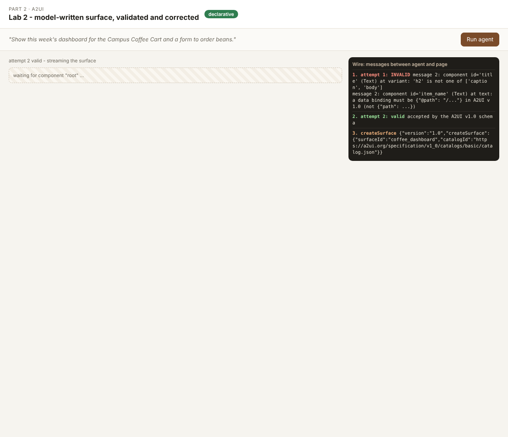
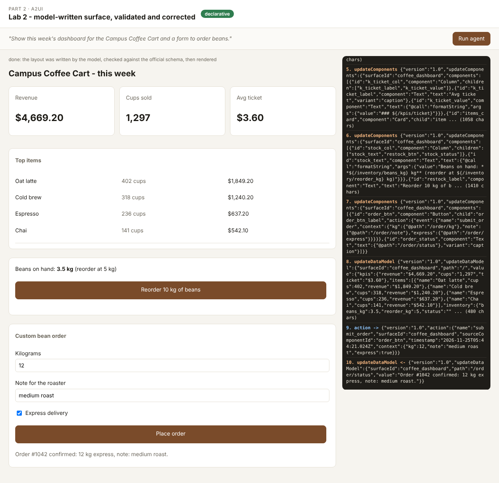

# Part 2 · Lab 2 - A2UI, declarative mode: the model writes the surface (and fixes it)

**What this lab adds:** the model now writes every A2UI message itself as JSONL: `createSurface`, a flat `updateComponents` list from the Basic Catalog, and `updateDataModel`. The system prompt is generated from the official basic catalog. Each stream is validated against the official v1.0 schemas **before** it is sent - and validation errors are treated as *results*: they go back to the model, which tries again (max. 3 attempts). The valid surface is streamed in batches, root first, and includes an order form with **two-way binding**.

## Run it

```bash
cd 02_a2ui/lab2_declarative
python server.py              # http://127.0.0.1:8022
python demo.py
python -m pytest test_lab.py
```

## Recorded run

<!-- demo-output:start -->
```text
$ python demo.py
========================================================================
Part 2 / Lab 2.2 - A2UI declarative: the model writes the surface
========================================================================
system prompt (generated from the official basic catalog), first lines:
  | You generate A2UI v1.0 messages, one JSON object per line (JSONL), no prose, no fences.
  | Every message has "version": "1.0". Start with createSurface, then updateComponents, then updateData
  | Components are a FLAT list; children are referenced by id; exactly one component has id "root".
  | Bind values with {"@path": "/json/pointer"}; inside a List template use relative paths like {"@path"
  | Text has variant "caption" or "body" only; write headings as Markdown ("## Title").
attempt 1: INVALID
   - message 2: component id='title' (Text) at variant: 'h2' is not one of ['caption', 'body']
   - message 2: component id='item_name' (Text) at text: a data binding must be {"@path": "/..."} in A2UI v1.0 (not {"path"
attempt 2: VALID
streamed: createSurface, updateComponents(12), updateComponents(12), updateComponents(12), updateComponents(2), updateDataModel
official renderer core (@a2ui/web_core): accepted
action  -> {"kg":12,"note":"medium roast","express":true} <- {"surfaceId":"coffee_dashboard","path":"/order/status","value":"Order #1042 confirmed: 12 kg express, note:...
screenshot: screenshot_partial.png
screenshot: screenshot.png
```
<!-- demo-output:end -->

| While batches arrive (placeholders for missing children) | Final surface after submitting the bound form |
|---|---|
|  |  |

The scripted first attempt contains two mistakes that models trained on older A2UI really make: `"variant": "h2"` (v1.0 allows only `caption`/`body`; headings are Markdown) and `{"path": "name"}` (v1.0 requires `{"@path": ...}`).

## Code walkthrough

**Step 1 - a prompt generated from the official catalog.**

`../shared/a2ui.py`:
```python
def catalog_prompt(with_html: bool = False) -> str:
    """A compact system prompt generated from the official basic catalog (and ours)."""
    basic = _load("basic_catalog.json")
```

**Step 2 - the correction loop.** Parse, validate, and on failure send the errors back.

`server.py`:
```python
    for attempt in range(1, MAX_ATTEMPTS + 1):
        reply = llm.text(system=SYSTEM, user=user, fixture=f"attempt{attempt}")
...
        # validation errors are a result: send them back and ask for a corrected stream
        user = (f"{prompt}\n\nYour previous A2UI messages failed validation:\n- " + "\n- ".join(errors)
```

**Step 3 - readable errors.** jsonschema's raw `oneOf` errors are hard for a model to act on, so each failing component is re-validated against *its own* catalog entry.

`../shared/a2ui.py`:
```python
    errs = sorted(_validator(SPEC_BASE + f"catalog.json#/components/{name}", with_html).iter_errors(comp), key=lambda e: list(e.path))
```

**Step 4 - stream in batches, root first** so the renderer shows placeholders for children still in flight.

`server.py`:
```python
            third = max(1, len(comps) // 3)
            for i in range(0, len(comps), third):
                yield a2ui.update_components(sid, comps[i:i + third])
```

**Step 5 - two-way binding in the renderer.** Typing writes into the data model; nothing is sent until an action.

`../shared/web/surface.js`:
```js
    input.addEventListener("input", () => { if (path) s.data = setPointer(s.data, path, c.variant === "number" ? Number(input.value) : input.value); });
```

**Step 6 - the action carries the bound values; the agent validates them.**

`server.py`:
```python
    if act["name"] == "submit_order":
        kg = ctx.get("kg")
        if not isinstance(kg, (int, float)) or not 1 <= kg <= 50:
```

## What to notice

- The validator is the contract: the model may design any layout, but only one the official schema and catalog accept.
- The demo shows the official `@a2ui/web_core` processor agreeing with our verdicts (it rejects attempt 1 for the same `h2` reason - try `node ../shared/conformance.mjs fixtures/attempt1.jsonl`).
- The form state lives in the data model on the client until the user acts - the agent sees it only inside the action's `context`.

## Tests (`test_lab.py`)

Attempt 1 is rejected with readable errors; the errors are in the second prompt; attempt 2 is valid and accepted by the official core; three invalid attempts raise; components stream in batches root-first; the order action validates the bound values.
