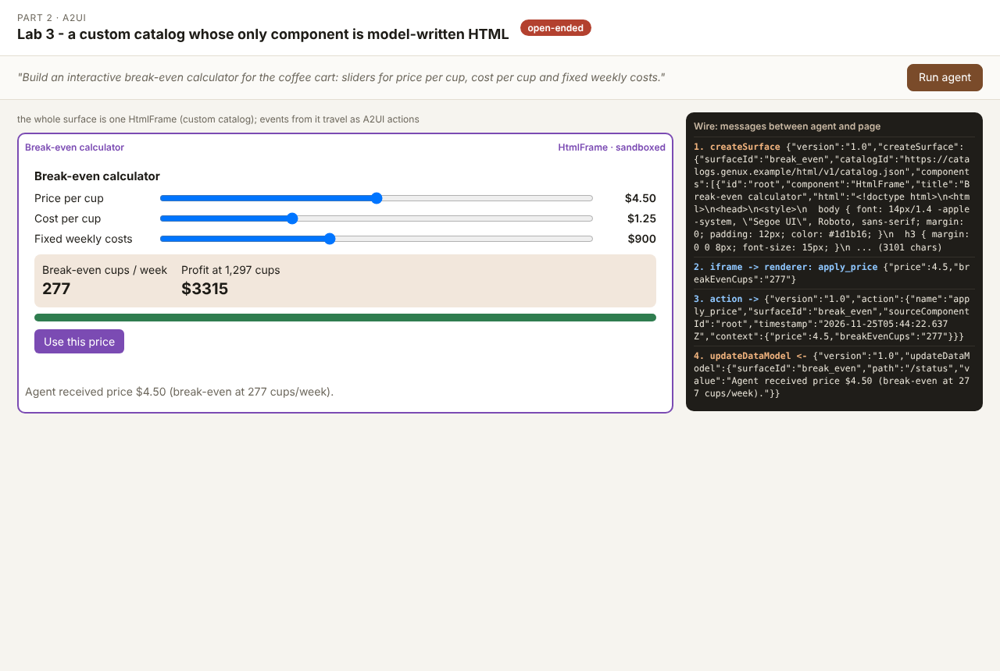

# Part 2 · Lab 3 - A2UI, open-ended mode: a custom catalog whose only component is HTML

**What this lab adds:** A2UI is declarative by design - the Basic Catalog contains nothing that runs model-written code, and that is a safety property, not an omission. Open-ended generation is still possible *the A2UI way*: through a **custom catalog**. [`../shared/schema/genux_html_catalog.json`](../shared/schema/genux_html_catalog.json) defines one component, `HtmlFrame`, whose `html` property is a whole document that the renderer sandboxes. Here the surface's default catalog *is* that custom catalog, so the entire surface is one model-written widget - but it still travels, binds data and sends events as standard A2UI.

## Run it

```bash
cd 02_a2ui/lab3_open_ended
python server.py              # http://127.0.0.1:8023
python demo.py
python -m pytest test_lab.py
```

## Recorded run

<!-- demo-output:start -->
```text
$ python demo.py
========================================================================
Part 2 / Lab 2.3 - A2UI open-ended: one HtmlFrame from a custom catalog
========================================================================
createSurface catalogId: https://catalogs.genux.example/html/v1/catalog.json
component: {"id":"root","component":"HtmlFrame","title":"Break-even calculator","html":"<2581 chars of HTML>","caption":{"@path":"/status"},"allowedEvents":["apply_pric...
validate against basic catalog only : component id='root': unknown component 'HtmlFrame'; allowed: Text, Image, Icon, Video, Aud
validate with the custom catalog    : valid
official renderer core (@a2ui/web_core) + custom catalog: accepted
browser: iframe event -> 2. iframe -> renderer: apply_price {"price":4.5,"breakEvenCups":"277"}
         A2UI action  -> 3. action -> {"version":"1.0","action":{"name":"apply_price","surfaceId":"break_even","sourceComponentId":"roo
screenshot: screenshot.png
```
<!-- demo-output:end -->



## Code walkthrough

**Step 1 - define the custom catalog** in the shape the A2UI catalog definition schema requires (`catalogId`, `protocolVersion`, `components`, `instructions`).

`../shared/schema/genux_html_catalog.json` (excerpt):
```json
"HtmlFrame": {"properties": {"component": {"const": "HtmlFrame"},
  "html": {"type": "string"}, "caption": {"$ref": "common_types.json#/$defs/DynamicString"},
  "allowedEvents": {"type": "array", "items": {"type": "string"}}},
  "required": ["component", "html"]}
```

**Step 2 - the model writes HTML; the policy checks it; the server wraps it in A2UI.** The caption is a normal data binding.

`server.py`:
```python
    problems = check_html(html)
...
    frame = {"id": "root", "component": "HtmlFrame", "title": "Break-even calculator", "html": html,
             "caption": {"@path": "/status"}, "allowedEvents": ["apply_price"]}
```

**Step 3 - validation must know the custom catalog.** Against the basic catalog alone the message is rejected (`unknown component 'HtmlFrame'`); with the custom catalog registered it passes - in our validator and in Google's `@a2ui/web_core` (see `../shared/conformance.mjs`, which registers the catalog with `new Catalog(HTML_CATALOG_ID, "1.0", [HtmlFrameApi])`).

`server.py`:
```python
    errors = a2ui.validate_stream(msgs, with_html=True)   # the custom catalog is part of validation
```

**Step 4 - the renderer resolves the catalog per component** (v1.0 rule: component `@catalogId`, else the surface default; unknown catalogs are an error, never a fallback).

`../shared/web/surface.js`:
```js
    const catalog = c["@catalogId"] || s.catalogId;
    if (!SUPPORTED.has(catalog)) return h("div", { class: "g-error" }, `catalog not supported: ${catalog}`);
```

**Step 5 - an event inside the sandbox becomes an A2UI action** with `sourceComponentId` = the HtmlFrame's id, so the agent handles it like any Button.

`../shared/web/surface.js`:
```js
        this.fire(s, c.id, name, Object.fromEntries(Object.entries(payload || {}).map(([k, v]) => [k, v])), scope);
```

## What to notice

- A renderer that does not know the custom catalog cannot be tricked into running HTML: it shows "catalog not supported". Open-ended UI is opt-in on both sides.
- The model's freedom is total inside the frame and zero outside it: the caption, the data model and the action format are all standard A2UI.
- The event payload is still untrusted - the agent re-validates the price (`handle_action`).

## Tests (`test_lab.py`)

The surface uses the custom catalog; basic-only validation rejects it and custom validation accepts it; the official core accepts it with the catalog registered; network-using HTML is blocked; the frame event validates as a standard renderer-to-agent action and bad payloads are ignored.
