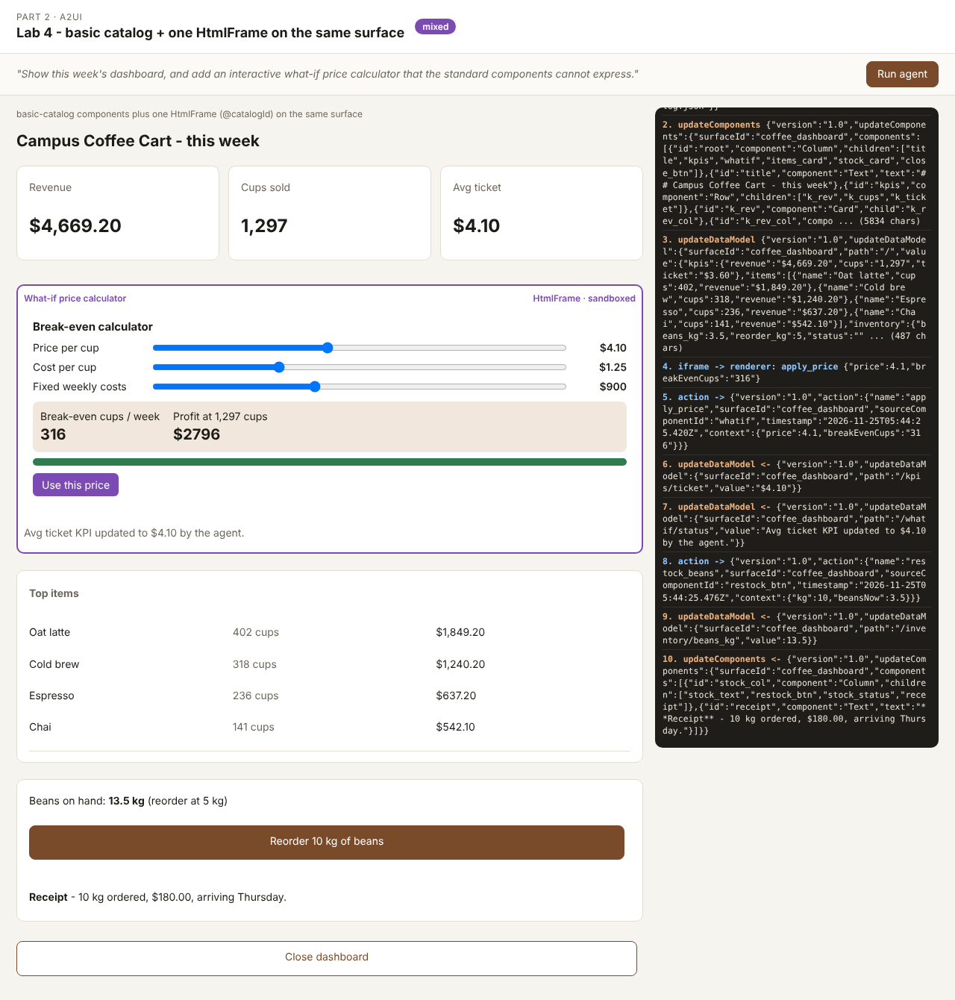

# Part 2 · Lab 4 - A2UI, mixed mode: two catalogs on one surface

**What this lab adds:** A2UI v1.0's *mixable catalogs*. The surface's default catalog is the official Basic Catalog; exactly one component carries `"@catalogId": "https://catalogs.genux.example/html/v1/catalog.json"` and is an `HtmlFrame` - the escape hatch from lab 3 - placed between the KPIs and the top-items list. The agent then answers user actions with **all four** agent-to-renderer messages, including an `updateComponents` that adds a receipt to the live surface and a `deleteSurface`.

## Run it

```bash
cd 02_a2ui/lab4_mixed
python server.py              # http://127.0.0.1:8024
python demo.py
python -m pytest test_lab.py
```

## Recorded run

<!-- demo-output:start -->
```text
$ python demo.py
========================================================================
Part 2 / Lab 2.4 - A2UI mixed: basic catalog + one HtmlFrame on one surface
========================================================================
(surface default: basic): 31 components (Button, Card, Column, List, Row, Text)
https://catalogs.genux.example/html/v1/catalog.json: 1 components (HtmlFrame)
official renderer core (@a2ui/web_core): accepted
action restock_beans -> updateDataModel, updateComponents
      {"version":"1.0","updateDataModel":{"surfaceId":"coffee_dashboard","path":"/inventory/beans_kg","value":13.5}}
      {"version":"1.0","updateComponents":{"surfaceId":"coffee_dashboard","components":[{"id":"stock_col","component":"...
action apply_price   -> updateDataModel, updateDataModel
      {"version":"1.0","updateDataModel":{"surfaceId":"coffee_dashboard","path":"/kpis/ticket","value":"$4.10"}}
      {"version":"1.0","updateDataModel":{"surfaceId":"coffee_dashboard","path":"/whatif/status","value":"Avg ticket KP...
action close_surface -> deleteSurface
      {"version":"1.0","deleteSurface":{"surfaceId":"coffee_dashboard"}}
after restock the frame kept its slider at: $4.10
screenshot: screenshot.png
close_surface -> deleteSurface: surface removed from the page
```
<!-- demo-output:end -->



| Action | Source | Agent's answer |
|---|---|---|
| `apply_price` | the HtmlFrame (`sourceComponentId: "whatif"`) | `updateDataModel` on the Basic-Catalog KPI `/kpis/ticket` |
| `restock_beans` | Basic-Catalog Button | `updateDataModel` + `updateComponents` (new `receipt` Text) |
| `close_surface` | borderless Button | `deleteSurface` |

## Code walkthrough

**Step 1 - one component opts into the second catalog.**

`../shared/dashboard.py`:
```python
        comps.append({"id": "whatif", "component": "HtmlFrame", "@catalogId": HTML_CATALOG_ID,
                      "title": "What-if price calculator", "html": html, "caption": {"@path": "/whatif/status"},
                      "allowedEvents": ["apply_price"]})
```

**Step 2 - hybrid policy on top of schema validation**: at most one HtmlFrame, it must declare its catalog, and its HTML must pass the policy.

`server.py`:
```python
    if len(frames) > 1:
        errors.append("at most one HtmlFrame is allowed")
    for f in frames:
        if f.get("@catalogId") != a2ui.HTML_CATALOG_ID:
```

**Step 3 - the agent changes structure on a live surface.**

`server.py`:
```python
            a2ui.update_components(sid, [
                {"id": "stock_col", "component": "Column", "children": ["stock_text", "restock_btn", "stock_status", "receipt"]},
```

**Step 4 - events are only trusted from the component that may send them.**

`server.py`:
```python
    elif name == "apply_price" and act["sourceComponentId"] == "whatif":
```

**Step 5 - targeted re-render keeps the sandbox alive.** After the first paint, `updateComponents` re-renders only the updated ids, so the calculator keeps the user's slider position (the demo prints it after the restock).

`../shared/web/surface.js`:
```js
      if (!s.el.querySelector("[data-id=root]") || s.el.querySelector(".g-skeleton")) this.render(s.id);
```

## What to notice

- The mixed surface still validates against the official schema and is accepted by `@a2ui/web_core` with both catalogs registered.
- Removing the `@catalogId` from the HtmlFrame makes the stream invalid (test `test_htmlframe_without_catalog_id_is_rejected`): mixing is explicit, per component.
- The generated region changed a Basic-Catalog KPI only through the agent - the frame itself has no access to the data model.

## Tests (`test_lab.py`)

One HtmlFrame from the custom catalog, everything else basic; official core accepts the mixed surface; an HtmlFrame without `@catalogId` is rejected; all four message types appear; `apply_price` is accepted only from the frame.
