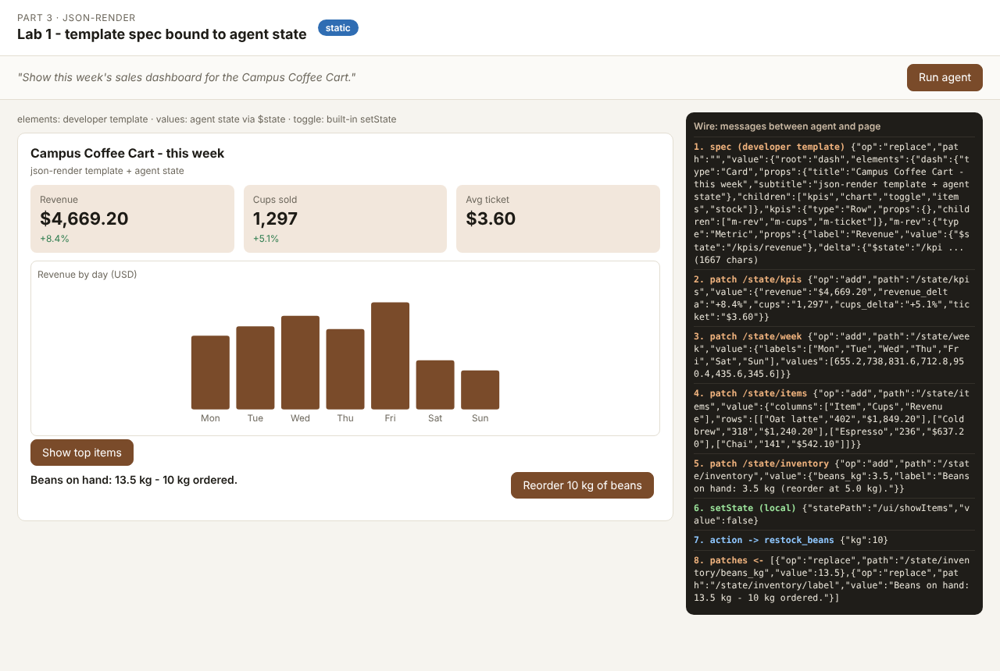

# Part 3 · Lab 1 - json-render, static mode: a template spec bound to agent state

**What this lab adds:** json-render's `state` model and `$state` expressions. The developer writes the spec once - 11 elements whose values are `{"$state": "/kpis/revenue"}`-style expressions, a built-in `setState` toggle and a custom `restock_beans` action. The agent writes no elements at all: it fills one function call, `fill_state(...)`, and the server streams the arguments as SpecStream patches on `/state`.

## Run it

```bash
cd 03_json_render/lab1_static
python server.py              # http://127.0.0.1:8031
python demo.py
python -m pytest test_lab.py
```

## Recorded run

<!-- demo-output:start -->
```text
$ python demo.py
========================================================================
Part 3 / Lab 3.1 - json-render static: developer template + agent state
========================================================================
op 1: replace '' with the template spec (11 elements). Bindings, e.g.:
      m-rev {"type":"Metric","props":{"label":"Revenue","value":{"$state":"/kpis/revenue"},"delta":{"$state":"/kpis/revenue_del...
      items {"type":"Table","props":{"columns":{"$state":"/items/columns"},"rows":{"$state":"/items/rows"}},"visible":{"$state"...
      toggle {"type":"Button","props":{"label":{"$cond":{"$state":"/ui/showItems"},"$then":"Hide top items","$else":"Show top it...
op: add /state/kpis        {"revenue":"$4,669.20","revenue_delta":"+8.4%","cups":"1,297","cups_delta":"+...
op: add /state/week        {"labels":["Mon","Tue","Wed","Thu","Fri","Sat","Sun"],"values":[655.2,738.0,8...
op: add /state/items       {"columns":["Item","Cups","Revenue"],"rows":[["Oat latte","402","$1,849.20"],...
op: add /state/inventory   {"beans_kg":3.5,"label":"Beans on hand: 3.5 kg (reorder at 5.0 kg)."}
@json-render/core validateSpec + catalog Zod props: valid
action restock_beans -> [{"op":"replace","path":"/state/inventory/beans_kg","value":13.5},{"op":"replace","path":"/state/inventory/label","va...
screenshot: screenshot.png
```
<!-- demo-output:end -->



## Code walkthrough

**Step 1 - the template: values are expressions, behaviour is bindings.** `$cond` picks the button label; `visible` hides the table; `on.press` names an action.

`../shared/specs.py`:
```python
        "m-rev": E("Metric", {"label": "Revenue", "value": st("/kpis/revenue"), "delta": st("/kpis/revenue_delta")}),
...
        "items": E("Table", {"columns": st("/items/columns"), "rows": st("/items/rows")}, visible={"$state": "/ui/showItems"}),
...
        "restock": E("Button", {"label": "Reorder 10 kg of beans"}, on={"press": {"action": "restock_beans", "params": {"kg": 10}}}),
```

**Step 2 - the agent's whole job is one schema-checked function call.**

`server.py`:
```python
    reply = llm.chat(messages=[{"role": "system", "content": SYSTEM}, {"role": "user", "content": prompt}],
                     tools=[FILL_TOOL], fixture="fill_state")
```

**Step 3 - everything travels as SpecStream patches**: one `replace ""` with the template, then `/state` patches.

`server.py`:
```python
    ops = [{"op": "replace", "path": "", "value": {**TEMPLATE, "state": {"ui": {"showItems": True}}}}]
    ops += [{"op": "add", "path": f"/state/{k}", "value": args[k]} for k in ("kpis", "week", "items", "inventory")]
```

**Step 4 - the renderer resolves expressions and remembers what each element read.**

`../shared/web/jr-render.js`:
```js
  read(id, path) { this.deps.get(id)?.add(path); return getPointer(this.spec.state, path); }
```

**Step 5 - built-in vs custom actions.** `setState` runs in the page; anything else goes to the server, which answers with patches.

`../shared/web/jr-render.js`:
```js
      if (BUILTIN.has(b.action)) {                    // built-in: change state locally, no server round trip
...
        await this.onAction?.(b.action, params, id);  // custom: the application decides
```

**Step 6 - a state patch re-renders only the elements that read that path.**

`../shared/web/jr-render.js`:
```js
    for (const [id, deps] of [...this.deps]) {
      if (!hit(deps) || this.spec.elements[id]?.type === "HtmlBlock") continue;
```

## What to notice

- Compared with A2UI lab 1: same idea (structure from the developer, data from the agent), different mechanism - json-render puts data in a `state` object inside the spec and uses `$state` expressions instead of a separate data-model message.
- The wire panel shows `setState (local)`: hiding the table never reaches the server.
- `@json-render/core`'s `validateSpec` and the catalog's Zod schemas accept the template (demo line "valid").

## Tests (`test_lab.py`)

Template values are `$state` expressions; the agent only patches `/state`; the applied stream is a valid spec with data; the official library accepts the template; the restock action returns state patches and unknown actions are refused.
