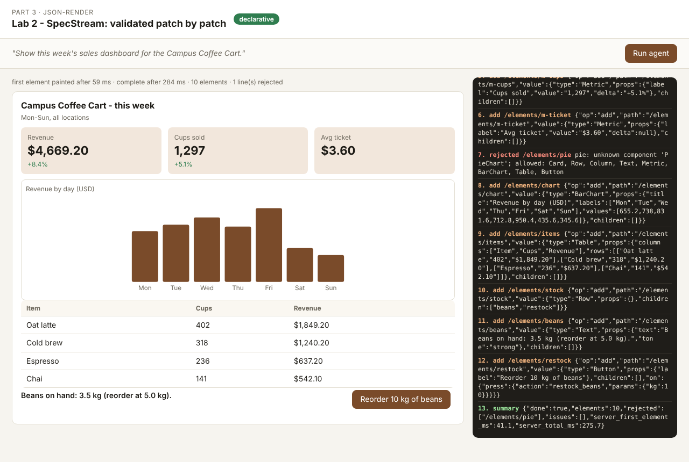

# Part 3 · Lab 2 - json-render, declarative mode: SpecStream, validated patch by patch

**What this lab adds:** json-render's native generation format. The system prompt is exactly what the library generates from the catalog (`catalog.prompt()`). The model answers with **SpecStream** - JSONL, one RFC 6902 patch per line. The server validates **each line the moment it is complete** and forwards it, so the page paints the first element long before the model finishes. The scripted reply contains one hallucinated component (`PieChart`): that single line is dropped and reported, the rest of the dashboard is unaffected.

## Run it

```bash
cd 03_json_render/lab2_declarative
python server.py              # http://127.0.0.1:8032
python demo.py
python -m pytest test_lab.py
```

## Recorded run

<!-- demo-output:start -->
```text
$ python demo.py
========================================================================
Part 3 / Lab 3.2 - json-render declarative: SpecStream patches, validated as they stream
========================================================================
system prompt = catalog.prompt() from @json-render/core: 16,648 chars; components section:
  | - Card: { title: string, subtitle?: string } - A titled container; children go inside.
  | - Row: {  } - Lays its children out side by side.
  | - Column: {  } - Stacks its children vertically.
  | - Text: { text: string, tone?: "normal" | "muted" | "strong" } - One paragraph of text.
  accepted add /root
  accepted add /elements/dash
  accepted add /elements/kpis
  accepted add /elements/m-rev
  accepted add /elements/m-cups
  accepted add /elements/m-ticket
  REJECTED /elements/pie: pie: unknown component 'PieChart'; allowed: Card, Row, Column, Text, Metric, BarChart, Table, Button
  accepted add /elements/chart
  accepted add /elements/items
  accepted add /elements/stock
  accepted add /elements/beans
  accepted add /elements/restock
summary: {"elements":10,"rejected":["/elements/pie"],"issues":[],"server_first_element_ms":87.3,"server_total_ms":321.3}
official compileSpecStream on the RAW model output : ['pie: unknown component PieChart; allowed: Card, Row, Column, Text, Metric, BarChart, Table, Button']
official compileSpecStream on the ACCEPTED patches: valid | same spec as Python: True
browser: first element painted after 59 ms · complete after 284 ms · 10 elements · 1 line(s) rejected
screenshot: screenshot.png
```
<!-- demo-output:end -->



## Code walkthrough

**Step 1 - the catalog, defined once with the official library (Zod props).**

`../shared/catalog.mjs`:
```js
  Metric: { props: z.object({ label: z.string(), value: z.string(), delta: z.string().nullable() }), description: "One key number with a label and an optional change such as '+8%'." },
...
export const catalog = defineCatalog(schema, { components, actions });
```

**Step 2 - generate the prompt and the per-component schemas from it** (`node ../shared/build.mjs`).

`../shared/build.mjs`:
```js
  writeFileSync(new URL(`./generated/prompt_${name}.txt`, import.meta.url),
    cat.prompt({ system: "You build UIs for a coffee-cart analytics app.", customRules: RULES[name] }));
...
  const props = Object.fromEntries(Object.entries(cat.data.components).map(([n, c]) => [n, z.toJSONSchema(c.props)]));
```

**Step 3 - re-cut the model's chunks into lines; a complete line is a complete patch.**

`server.py`:
```python
def lines(chunks):
    """Re-cut a stream of text chunks into complete lines (a complete line = a complete patch)."""
```

**Step 4 - validate each element patch on arrival; drop the bad line, keep streaming.**

`server.py`:
```python
        errors = check_op(op, cat)
        if errors:
            rejected.append(op["path"])
            yield "meta", {"rejected": op["path"], "errors": errors}
            continue
```

**Step 5 - Python validation from the exported Zod schemas**; render-time expressions are skipped, nullable props may be omitted.

`../shared/jr.py`:
```python
    for e in Draft202012Validator(schema).iter_errors(_props_for_validation(el.get("props") or {}, schema)):
```

**Step 6 - the page renders after every patch and measures first paint.**

`page/app.js`:
```js
    view.applyPatches([msg]);                         // render after EVERY patch
    if (firstPaint === null && msg.path.startsWith("/elements/")) firstPaint = Math.round(performance.now() - t0);
```

## What to notice

- **Two opinions on one stream.** The library's `compileSpecStream` on the *raw* model output reports `PieChart`; on the *accepted* patches it reports nothing, and it builds exactly the same spec as the Python side (`same spec as Python: True`).
- Flat element maps stream well: the card frame is on screen after the first element patch; children fill in as skeletons resolve (compare AG-UI lab 2, which streamed the same idea as STATE_DELTA).
- Validation per line means one bad component costs one element, not the whole answer.

## Tests (`test_lab.py`)

The prompt is the library's own; the hallucinated component is dropped while 10 elements stream; patches arrive parent-first; Python and the official `compileSpecStream` agree; a non-JSON line is reported; the last line without a newline is not lost.
