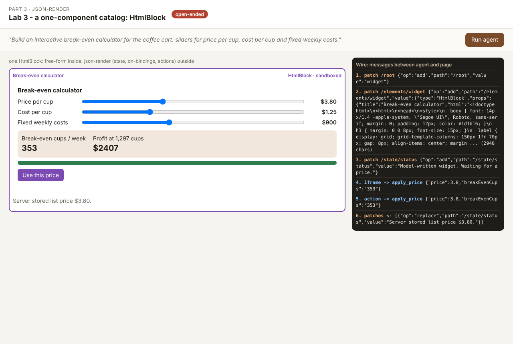

# Part 3 · Lab 3 - json-render, open-ended mode: a one-component catalog

**What this lab adds:** the catalog shrinks to a single component, `HtmlBlock(title, html, caption)` - the `htmlCatalog` in `shared/catalog.mjs`. The model still answers in SpecStream, but its one element carries a whole model-written document. What makes this different from plain "return some HTML": json-render's machinery still surrounds the free-form region - the caption is a `$state` expression, the element's `on` map is the allow-list of events that may leave the sandbox, and actions are answered with `/state` patches.

## Run it

```bash
cd 03_json_render/lab3_open_ended
python server.py              # http://127.0.0.1:8033
python demo.py
python -m pytest test_lab.py
```

## Recorded run

<!-- demo-output:start -->
```text
$ python demo.py
========================================================================
Part 3 / Lab 3.3 - json-render open-ended: a catalog with only HtmlBlock
========================================================================
  add /root              "widget"
  add /elements/widget   {"type":"HtmlBlock","props":{"title":"Break-even calculator","html":"<2582 chars>","caption":{"$state":"/status"}},"c...
  add /state/status      "Model-written widget. Waiting for a price."
the HtmlBlock document is 873 tokens (o200k_base via gpt-tokenizer)
official compileSpecStream + htmlCatalog props: valid
bad event -> [{"op":"replace","path":"/state/status","value":"Ignored an invalid event from the HtmlBlock."}]
screenshot: screenshot.png
```
<!-- demo-output:end -->



## Code walkthrough

**Step 1 - a catalog with one component.**

`../shared/catalog.mjs`:
```js
const HtmlBlock = {
  props: z.object({ title: z.string(), html: z.string(), caption: z.string().nullable() }),
...
export const htmlCatalog = defineCatalog(schema, { components: { HtmlBlock }, actions: { apply_price: actions.apply_price } });
```

**Step 2 - the element: free-form `html`, but state-bound caption and an explicit event map.**

`../shared/specs.py`:
```python
        "widget": E("HtmlBlock", {"title": "Break-even calculator", "html": break_even_html(), "caption": {"$state": "/status"}},
                    on={"apply_price": {"action": "apply_price"}}),
```

**Step 3 - catalog validation plus the HTML policy before anything is streamed.**

`server.py`:
```python
    errors = jr.validate(spec, "html")
    for eid, el in spec["elements"].items():
        errors += [f"{eid}: {p}" for p in check_html(el["props"].get("html", ""))]
```

**Step 4 - the `on` map is the sandbox allow-list.** Only event names the spec binds may leave the iframe; the caption updates in place so the iframe is never re-created.

`../shared/web/jr-render.js`:
```js
        allowed: Object.keys(el.on || {}),           // only events the spec binds may leave the frame
...
      if (caption.$state) this.live.push({ path: caption.$state, update });
```

**Step 5 - the server treats the event as untrusted input.**

`server.py`:
```python
    if body.get("action") != "apply_price" or not isinstance(price, (int, float)) or not 2 <= price <= 7:
```

## What to notice

- The document's token count is printed by the demo: one widget costs more output than the whole declarative dashboard spec (see the token table in Part 1, lab 3). Open-ended output is expensive.
- Swapping the catalog changed the mode; the protocol (SpecStream), the validator and the renderer stayed the same.

## Tests (`test_lab.py`)

One HtmlBlock with a `$state` caption and an event binding; the html catalog rejects other components; the official library accepts the stream; HTML that loads a remote image is refused; the action validates the price.
