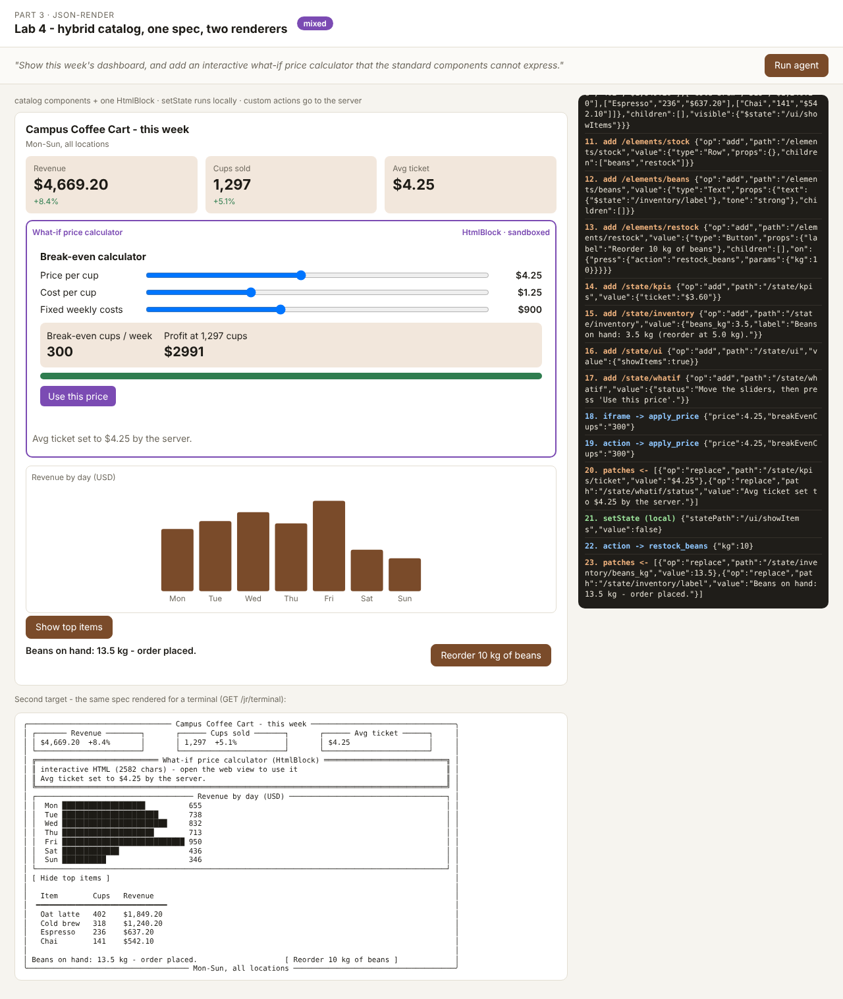

# Part 3 · Lab 4 - json-render, mixed mode: hybrid catalog, one spec, two renderers

**What this lab adds:** everything together. The `hybridCatalog` is the base catalog plus one `HtmlBlock`. The model streams a single SpecStream with catalog elements, one sandboxed calculator, and `state`. Three kinds of behaviour live in that one spec: a built-in `setState` toggle (page only), a custom `restock_beans` action and the HtmlBlock's `apply_price` event (both answered by the server with `/state` patches). Then json-render's headline feature: the **same spec** is drawn by a second renderer, a terminal UI built with `rich`, where the HtmlBlock degrades to a labelled placeholder.

## Run it

```bash
cd 03_json_render/lab4_mixed
python server.py              # http://127.0.0.1:8034  (the terminal view is GET /jr/terminal)
python demo.py
python -m pytest test_lab.py
```

## Recorded run

<!-- demo-output:start -->
```text
$ python demo.py
========================================================================
Part 3 / Lab 3.4 - json-render mixed: hybrid catalog, one spec, two renderers
========================================================================
17 patches: 12 elements (BarChart, Button, Card, HtmlBlock, Metric, Row, Table, Text) + 4 state patches
official compileSpecStream + hybridCatalog props: valid
action restock_beans {'kg': 10} -> [{"op":"replace","path":"/state/inventory/beans_kg","value":13.5},{"op":"replace","path":"/state/inventory/label","va...
action apply_price {'price': 4.25} -> [{"op":"replace","path":"/state/kpis/ticket","value":"$4.25"},{"op":"replace","path":"/state/whatif/status","value":"...
action apply_price {'price': 400} -> [{"error":"refused action 'apply_price' with {'price': 400}"}]
--- the same spec, second renderer (rich, terminal):
╭───────────────────────────────── Campus Coffee Cart - this week ─────────────────────────────────╮
│ ┌─────── Revenue ────────┐       ┌────── Cups sold ───────┐       ┌────── Avg ticket ──────┐     │
│ │ $4,669.20  +8.4%       │       │ 1,297  +5.1%           │       │ $4.25                  │     │
│ └────────────────────────┘       └────────────────────────┘       └────────────────────────┘     │
│ ╔════════════════════════════ What-if price calculator (HtmlBlock) ════════════════════════════╗ │
│ ║ interactive HTML (2582 chars) - open the web view to use it                                  ║ │
│ ║ Avg ticket set to $4.25 by the server.                                                       ║ │
│ ╚══════════════════════════════════════════════════════════════════════════════════════════════╝ │
│ ┌──────────────────────────────────── Revenue by day (USD) ────────────────────────────────────┐ │
│ │  Mon ███████████████████          655                                                        │ │
│ │  Tue ██████████████████████       738                                                        │ │
│ │  Wed ████████████████████████     832                                                        │ │
│ │  Thu █████████████████████        713                                                        │ │
│ │  Fri ████████████████████████████ 950                                                        │ │
│ │  Sat █████████████                436                                                        │ │
│ │  Sun ██████████                   346                                                        │ │
   ...
│   Cold brew   318    $1,240.20                                                                   │
│   Espresso    236    $637.20                                                                     │
│   Chai        141    $542.10                                                                     │
│                                                                                                  │
│ Beans on hand: 13.5 kg - order placed.                    [ Reorder 10 kg of beans ]             │
╰───────────────────────────────────── Mon-Sun, all locations ─────────────────────────────────────╯
screenshot: screenshot.png
```
<!-- demo-output:end -->



## Code walkthrough

**Step 1 - the hybrid spec.** KPIs and the beans text read `$state`, so later answers are tiny state patches; the HtmlBlock binds one event.

`../shared/specs.py`:
```python
        elements["m-ticket"]["props"]["value"] = {"$state": "/kpis/ticket"}
...
        elements["whatif"] = E("HtmlBlock", {"title": "What-if price calculator", "html": break_even_html(), "caption": {"$state": "/whatif/status"}},
                               on={"apply_price": {"action": "apply_price"}})
```

**Step 2 - per-line validation with hybrid rules**: catalog, HTML policy, and at most one HtmlBlock.

`server.py`:
```python
        blocks += op["path"].startswith("/elements/") and op["value"].get("type") == "HtmlBlock"
        if blocks > 1:
            errors.append("only one HtmlBlock is allowed")
```

**Step 3 - custom actions are answered with state patches only.**

`server.py`:
```python
    elif action == "apply_price" and isinstance(params.get("price"), (int, float)) and 2 <= params["price"] <= 7:
        ops = [{"op": "replace", "path": "/state/kpis/ticket", "value": f"${params['price']:.2f}"},
```

**Step 4 - the second renderer maps the same catalog to terminal widgets.**

`../shared/terminal.py`:
```python
    if kind == "Metric":
        delta = f"  [green]{p['delta']}[/]" if p.get("delta") else ""
        return Panel(f"[bold]{p.get('value')}[/]{delta}", title=p.get("label"), box=box.SQUARE, width=26)
...
    if kind == "HtmlBlock":
```

**Step 5 - serve it next to the web view.**

`server.py`:
```python
    @app.get("/jr/terminal")
    def term(req):                   # the second renderer: same spec, drawn as text
```

## What to notice

- The terminal still shows the table after "Hide top items" in the browser: `setState` is page-local UI state, never sent to the server - by design.
- The open-ended region is the only part that does not survive a different renderer. That is the hybrid trade-off in one picture: keep generated regions small and optional.
- The server never re-sends elements after the first render; every update is a `/state` patch.

## Tests (`test_lab.py`)

Catalog components plus exactly one HtmlBlock; the official library accepts the hybrid stream; actions patch only `/state` and invalid or built-in actions are refused; the terminal renderer draws the same data and never emits the HTML.
