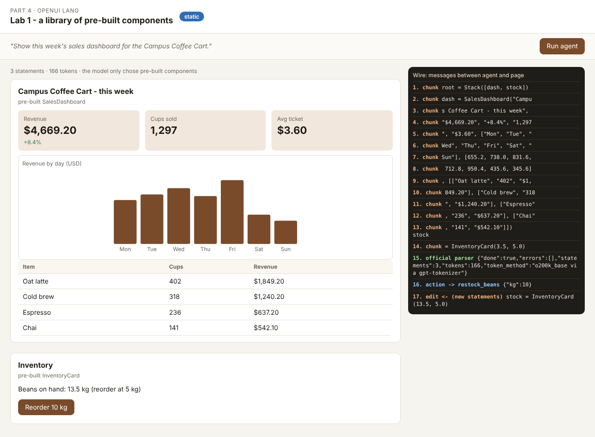

# Part 4 · Lab 1 - OpenUI Lang, static mode: a library of pre-built components

**What this lab adds:** in OpenUI Lang, *the library decides what exists*. Here the library contains only two high-level, pre-built components - `SalesDashboard(title, revenue, revenueDelta, cups, avgTicket, days, dailyRevenue, topItems)` and `InventoryCard(beansKg, reorderKg)` - so the model's whole answer is three lines that pick them and fill their positional arguments. How they look is entirely the page's code. A click returns as an action; the server answers with an OpenUI **edit** (a replacement statement).

## Run it

```bash
npm install && npm run build      # once, in the repository root (official parser + generated prompts)
cd 04_openui/lab1_static
python server.py                  # http://127.0.0.1:8041
python demo.py
python -m pytest test_lab.py
```

## Recorded run

<!-- demo-output:start -->
```text
$ python demo.py
========================================================================
Part 4 / Lab 4.1 - OpenUI Lang static: a library of pre-built components
========================================================================
prompt generated by library.prompt(); component signatures:
  | Stack(children: any[]) — Root container: stacks its children vertically.
  | SalesDashboard(title: string, revenue: string, revenueDelta: string, cups: string, avgTicket: string, days: st
  | InventoryCard(beansKg: number, reorderKg: number) — Pre-built stock card with a restock button.
model output (14 chunks):
  root = Stack([dash, stock])
  dash = SalesDashboard("Campus Coffee Cart - this week", "$4,669.20", "+8.4%", "1,297", "$3.60", ["Mon", "Tue"...
  stock = InventoryCard(3.5, 5.0)
server summary: {"done":true,"errors":[],"statements":3,"tokens":166,"token_method":"o200k_base via gpt-tokenizer"}
official parser: 3 elements, errors=[], unresolved=[]
action restock_beans -> edit: stock = InventoryCard(13.5, 5.0)
screenshot: screenshot.png
```
<!-- demo-output:end -->



## Code walkthrough

**Step 1 - define the pre-built components with the official library.** Positional arguments follow the Zod key order.

`../shared/library.mjs`:
```js
const prebuilt = [
  Stack,
  c("SalesDashboard", "The complete pre-built weekly sales dashboard (KPIs, revenue chart, top items).", {
```

**Step 2 - the prompt is the library's own.** `library.prompt()` writes the syntax rules and the signatures; the server only appends the data.

`server.py`:
```python
SYSTEM = oui.prompt(LIBRARY) + f"\n\nData:\n{scenario.as_text()}\nDaily revenue: {scenario.week_revenue()}"
```

**Step 3 - stream chunks; check the finished program with the official parser.**

`server.py`:
```python
    for chunk in llm.stream(system=SYSTEM, user=prompt, fixture="dashboard"):
        text += chunk
        yield sse_frame({"delta": chunk})
    errors = oui.check(text, LIBRARY)                 # the official parser, run once the program is complete
```

**Step 4 - the page: the official streaming parser, re-run on every chunk.**

`../shared/web/oui-render.js`:
```js
  set(text, complete = false) {
    this.program = text;
    const result = this.stream.set(text, complete);
```

**Step 5 - the pre-built renderers** - developer code, filled with the parsed arguments.

`page/app.js`:
```js
const PREBUILT = {
  SalesDashboard: (p) => C.Card({ title: p.title, subtitle: "pre-built SalesDashboard" }, [
```

**Step 6 - an action answered with an edit statement**, merged by `mergeStatements`.

`server.py`:
```python
    return {"patch": f"stock = InventoryCard({beans}, {scenario.INVENTORY['reorder_point_kg']})\n"}
```

## What to notice

- The whole UI costs ~100 tokens of model output: static mode is the cheapest and most predictable.
- `Metric(...)` is not in this library, and the parser reports it as an unknown component (`test_a_primitive_is_rejected_in_the_static_library`).
- Compare with AG-UI lab 1 (tool calls) and A2UI lab 1 (data model): three different mechanisms for the same "pick + fill" idea.

## Tests (`test_lab.py`)

The library offers only pre-built components; the program parses with the official parser into 3 elements; a primitive is rejected; the action answers with an edit statement.
