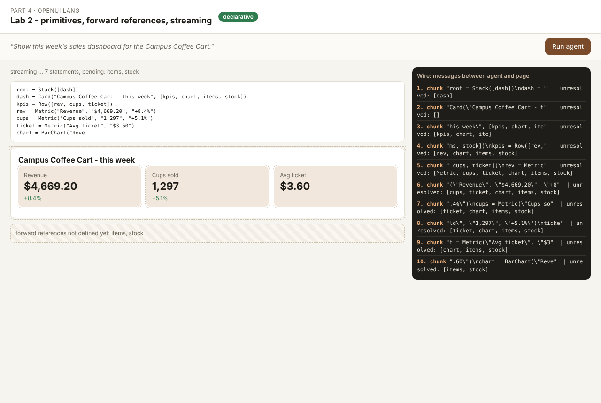
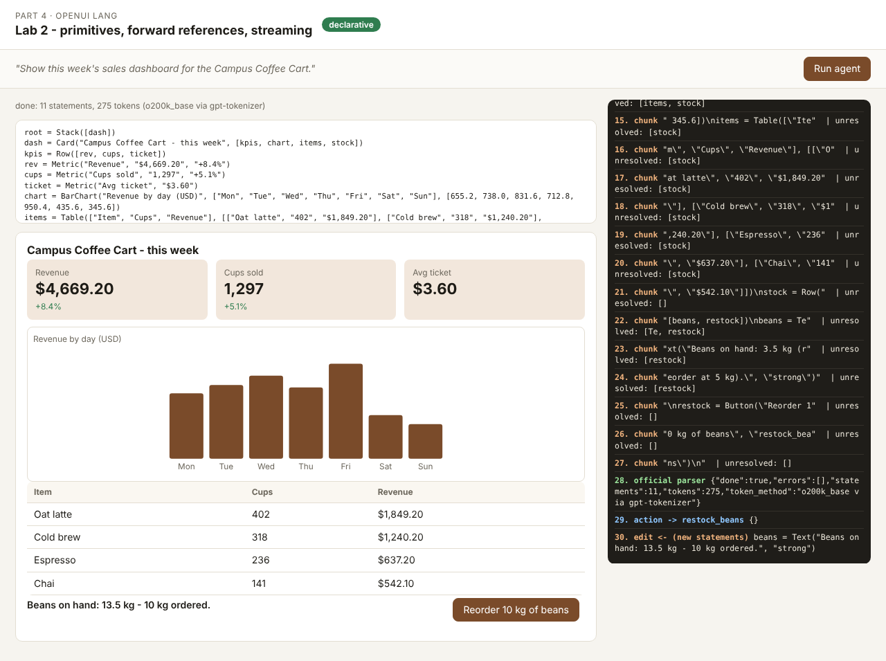

# Part 4 · Lab 2 - OpenUI Lang, declarative mode: primitives, forward references, streaming

**What this lab adds:** the library now holds primitives (`Stack`, `Card`, `Row`, `Text`, `Metric`, `BarChart`, `Table`, `Button`) and the model composes the layout. Line 2 (`dash = Card(..., [kpis, chart, items, stock])`) refers to four names that do not exist yet. The official streaming parser keeps them as **unresolved forward references**, renders what it can, and fills them in as their lines arrive. The demo also measures the same dashboard in three JSON formats with the o200k tokenizer.

## Run it

```bash
cd 04_openui/lab2_declarative
python server.py              # http://127.0.0.1:8042
python demo.py
python -m pytest test_lab.py
```

## Recorded run

<!-- demo-output:start -->
```text
$ python demo.py
========================================================================
Part 4 / Lab 4.2 - OpenUI Lang declarative: primitives, forward references, streaming
========================================================================
program (the model's whole answer):
  root = Stack([dash])
  dash = Card("Campus Coffee Cart - this week", [kpis, chart, items, stock])
  kpis = Row([rev, cups, ticket])
  rev = Metric("Revenue", "$4,669.20", "+8.4%")
  cups = Metric("Cups sold", "1,297", "+5.1%")
  ticket = Metric("Avg ticket", "$3.60")
  chart = BarChart("Revenue by day (USD)", ["Mon", "Tue", "Wed", "Thu", "Fri", "Sat", "Sun"], [655.2, 7...
  items = Table(["Item", "Cups", "Revenue"], [["Oat latte", "402", "$1,849.20"], ["Cold brew", "318", "...
  stock = Row([beans, restock])
  beans = Text("Beans on hand: 3.5 kg (reorder at 5 kg).", "strong")
  restock = Button("Reorder 10 kg of beans", "restock_beans")
after  2 lines:  2 elements rendered, unresolved forward refs = ['kpis', 'chart', 'items', 'stock']
after  4 lines:  4 elements rendered, unresolved forward refs = ['cups', 'ticket', 'chart', 'items', 'stock']
after  8 lines:  8 elements rendered, unresolved forward refs = ['stock']
same dashboard, output size (o200k_base via gpt-tokenizer):
  OpenUI Lang (this lab)             733 chars   275 tokens  1.00x
  json-render spec (flat JSON)      1294 chars   413 tokens  1.50x
  json-render SpecStream (JSONL)    1688 chars   527 tokens  1.92x
  nested JSON tree                  1043 chars   333 tokens  1.21x
action restock_beans -> edit: beans = Text("Beans on hand: 13.5 kg - 10 kg ordered.", "strong")
screenshot: screenshot_partial.png
screenshot: screenshot.png
```
<!-- demo-output:end -->

| Mid-stream: `items` and `stock` not defined yet | Complete, after a restock edit |
|---|---|
|  |  |

## Code walkthrough

**Step 1 - primitives in the library.**

`../shared/library.mjs`:
```js
  c("Metric", "One key number with a label and an optional change such as '+8%'.", { label: z.string(), value: z.string(), delta: z.string().optional() }),
```

**Step 2 - parse on every chunk and show what is still pending.**

`page/app.js`:
```js
    const result = view.set(text);                       // official streaming parser, re-run on every chunk
    shell.setStatus(`streaming ... ${result.meta.statementCount} statements, pending: ${result.meta.unresolved.join(", ") || "none"}`);
```

**Step 3 - unresolved names become a visible placeholder.**

`../shared/web/oui-render.js`:
```js
    const pending = result.meta.unresolved.length
      ? h("div", { class: "g-skeleton" }, `forward references not defined yet: ${result.meta.unresolved.join(", ")}`) : null;
```

**Step 4 - the parser runs in the browser** - the real one, bundled with esbuild from `@openuidev/lang-core`.

`../shared/web/oui-render.js`:
```js
import { createParser, createStreamingParser, mergeStatements } from "./vendor/openui-lang-core.js";
```

**Step 5 - measure.** The demo renders the same dashboard as json-render's flat spec, as a SpecStream and as a nested JSON tree, and counts tokens with o200k_base.

`demo.py`:
```python
    rows = [
        ("OpenUI Lang (this lab)", program),
        ("json-render spec (flat JSON)", compact(spec)),
```

## What to notice

- The demo prints how the unresolved set shrinks: after 2 lines four references are pending, after 8 only `stock`.
- In the recorded measurement OpenUI Lang is the shortest representation of this dashboard; the exact ratios depend on the UI and the tokenizer, so treat them as this sample's numbers, not a general law.
- An unfinished statement is simply not rendered yet (the half-written `BarChart` is absent in the partial screenshot) - nothing breaks.

## Tests (`test_lab.py`)

The program parses with the official parser into 11 elements; after two lines exactly `kpis, chart, items, stock` are unresolved; an unknown component is reported; an edit is a single replacement statement.
