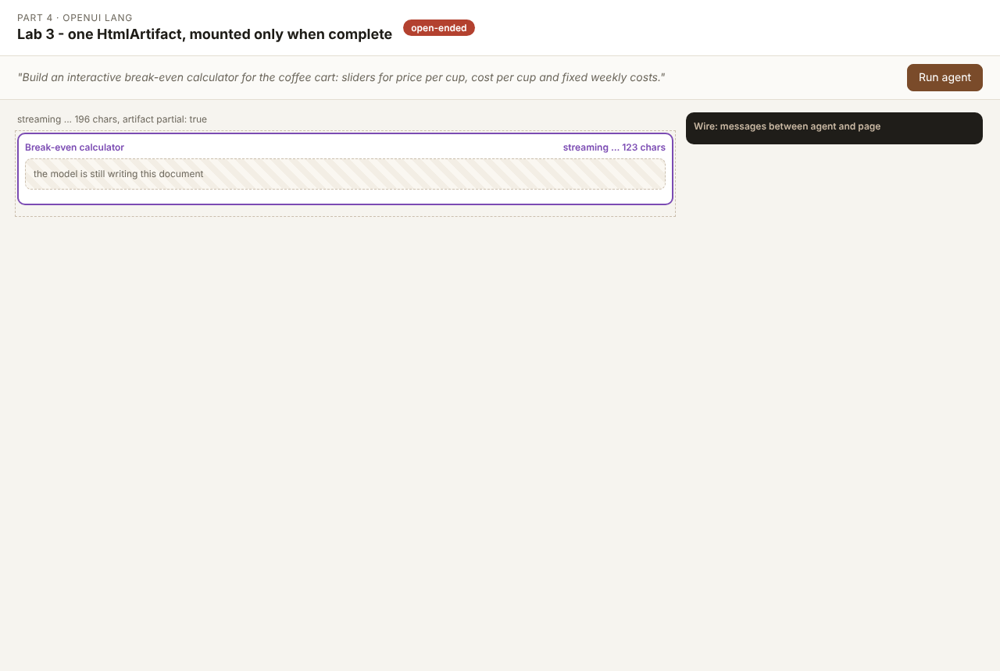
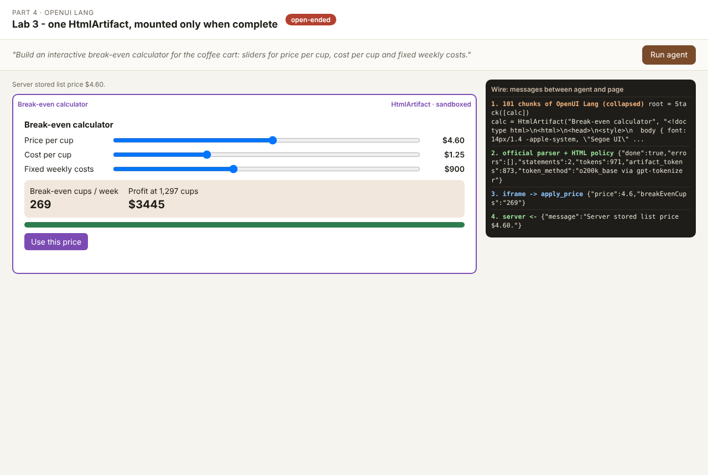

# Part 4 · Lab 3 - OpenUI Lang, open-ended mode: HtmlArtifact only

**What this lab adds:** OpenUI's own answer to open-ended UI, the **HtmlArtifact** pattern (from the "html-artifact" example in the OpenUI repository): a component whose argument is a complete HTML document. The library holds only `Stack` and `HtmlArtifact(title, document)`, so the answer is two lines. The document is a JSON-style string literal inside the program; while it streams, the official parser marks the element `partial`. The page shows a progress label and mounts the sandbox **only after the string is closed** - half a document never runs.

## Run it

```bash
cd 04_openui/lab3_open_ended
python server.py              # http://127.0.0.1:8043
python demo.py
python -m pytest test_lab.py
```

## Recorded run

<!-- demo-output:start -->
```text
$ python demo.py
========================================================================
Part 4 / Lab 4.3 - OpenUI Lang open-ended: HtmlArtifact only
========================================================================
library components: ['HtmlArtifact', 'Stack']
  root = Stack([calc])
  calc = HtmlArtifact("Break-even calculator", "<!doctype html>\n<html>\n<head>\n<style>\n  body { ...
official parser on the first half: HtmlArtifact partial=True, document so far 1280 chars
server summary: {"done":true,"errors":[],"statements":2,"tokens":971,"artifact_tokens":873,"token_method":"o200k_base via gpt-tokenizer"}
event apply_price {'price': 4.6} -> {'message': 'Server stored list price $4.60.'}
event apply_price {'price': '<script>'} -> {'error': "refused 'apply_price' with {'price': '<script>'}"}
screenshot: screenshot_partial.png
screenshot: screenshot.png
```
<!-- demo-output:end -->

| While the document streams | Mounted and used |
|---|---|
|  |  |

## Code walkthrough

**Step 1 - the escape hatch as a component.**

`../shared/library.mjs`:
```js
const HtmlArtifact = c("HtmlArtifact", "A complete, self-contained HTML document (inline CSS/JS, no network) shown in a sandbox. " +
```

**Step 2 - never run half a document.** A partial element gets a placeholder; a complete one is mounted once and reused.

`../shared/web/oui-render.js`:
```js
    if (known && !n.partial) return known;                    // already mounted: reuse, never reload
...
    if (n.partial || !document) {                             // do not run half a document
```

**Step 3 - the HTML policy runs on the parsed document**, not on the raw program text.

`server.py`:
```python
    docs = oui.artifact_documents(text, LIBRARY)
    errors += [f"HtmlArtifact: {p}" for d in docs for p in check_html(d)]   # the open-ended part gets the HTML policy
```

**Step 4 - events from the artifact are untrusted.**

`server.py`:
```python
    if body.get("action") != "apply_price" or not isinstance(price, (int, float)) or not 2 <= price <= 7:
```

## What to notice

- The program costs more tokens than the raw HTML: the document is escaped inside a string literal (`\n`, `\"`). The demo prints both numbers.
- Unlike AG-UI lab 3, the open-ended document travels *inside* the UI language, so the same parser, streaming and edit tools apply to it.

## Tests (`test_lab.py`)

One artifact that passes the parser and the policy; the artifact is partial until its string closes; the policy runs on the artifact document; artifact events are validated.
