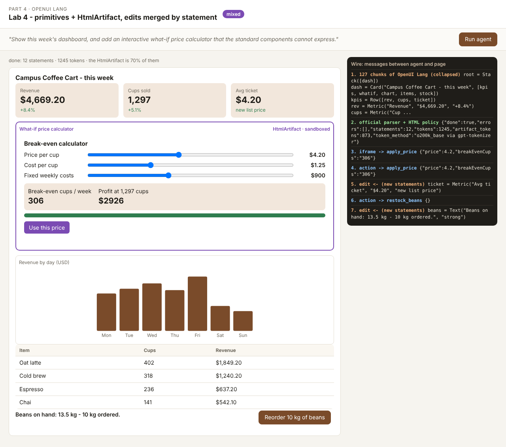

# Part 4 · Lab 4 - OpenUI Lang, mixed mode: primitives + one HtmlArtifact, edits by statement

**What this lab adds:** the hybrid library (primitives + `HtmlArtifact`) and OpenUI's **edit model** used for both kinds of user events. The model composes the dashboard and adds one artifact for the what-if calculator. A Button click and an event from inside the artifact both reach the server, which answers with *one replacement statement*; the page merges it with `mergeStatements` and re-renders only that statement - the sandboxed artifact is never re-mounted (the demo proves it by reading the slider value after both edits). The demo also reports how much of the token budget the artifact consumes.

## Run it

```bash
cd 04_openui/lab4_mixed
python server.py              # http://127.0.0.1:8044
python demo.py
python -m pytest test_lab.py
```

## Recorded run

<!-- demo-output:start -->
```text
$ python demo.py
========================================================================
Part 4 / Lab 4.4 - OpenUI Lang mixed: primitives + one HtmlArtifact, edits by statement
========================================================================
  root     = Stack([dash])
  dash     = Card("Campus Coffee Cart - this week", [kpis, whatif, chart, items, stock])
  kpis     = Row([rev, cups, ticket])
  rev      = Metric("Revenue", "$4,669.20", "+8.4%")
  cups     = Metric("Cups sold", "1,297", "+5.1%")
  ticket   = Metric("Avg ticket", "$3.60")
  whatif   = HtmlArtifact("What-if price calculator", "<!doctype html>\n<html>\n<head>\n<style>\n  bo...
  chart    = BarChart("Revenue by day (USD)", ["Mon", "Tue", "Wed", "Thu", "Fri", "Sat", "Sun"], [655...
  items    = Table(["Item", "Cups", "Revenue"], [["Oat latte", "402", "$1,849.20"], ["Cold brew", "31...
  stock    = Row([beans, restock])
  beans    = Text("Beans on hand: 3.5 kg (reorder at 5 kg).", "strong")
  restock  = Button("Reorder 10 kg of beans", "restock_beans")
official parser + policy: errors=[] | 1245 tokens, HtmlArtifact 873 = 70% (o200k_base via gpt-tokenizer)
event apply_price   -> {"patch":"ticket = Metric(\"Avg ticket\", \"$4.20\", \"new list price\")\n"}
event restock_beans -> {"patch":"beans = Text(\"Beans on hand: 13.5 kg - 10 kg ordered.\", \"strong\")\n"}
event apply_price   -> {"error":"refused 'apply_price' with {'price': 0}"}
after both edits the artifact still shows price $4.20 (it was not re-mounted)
screenshot: screenshot.png
```
<!-- demo-output:end -->



## Code walkthrough

**Step 1 - the hybrid library.**

`../shared/library.mjs`:
```js
  hybrid: createLibrary({ components: [...primitives, HtmlArtifact], root: "Stack" }),
```

**Step 2 - user events are answered with statements.**

`server.py`:
```python
    if action == "apply_price" and isinstance(price, (int, float)) and 2 <= price <= 7:
        return {"patch": f'ticket = Metric("Avg ticket", "${price:.2f}", "new list price")\n'}
```

**Step 3 - merge, re-parse, and replace only the changed statements.**

`../shared/web/oui-render.js`:
```js
    this.program = mergeStatements(this.program, patch);
...
      if (!changed.has(n.statementId)) return;
      this.container.querySelectorAll(`[data-id="${n.statementId}"]`).forEach((old) => old.replaceWith(this.node(n)));
```

**Step 4 - budget the escape hatch.**

`page/app.js`:
```js
      const share = Math.round((100 * msg.artifact_tokens) / msg.tokens);
```

## What to notice

- One `HtmlArtifact` is ~70% of the whole answer's tokens while the other 11 statements draw the entire dashboard: keep generated regions rare and small.
- Edits are tiny (one line) and need no IDs beyond the statement names the model already chose.
- Compare the update mechanisms across parts: AG-UI `STATE_DELTA`, A2UI `updateDataModel`/`updateComponents`, json-render `/state` patches, OpenUI statement edits.

## Tests (`test_lab.py`)

Primitives plus exactly one artifact; the official parser and the policy accept it and the artifact is more than half of the tokens; events become single-statement edits and invalid ones are refused.
