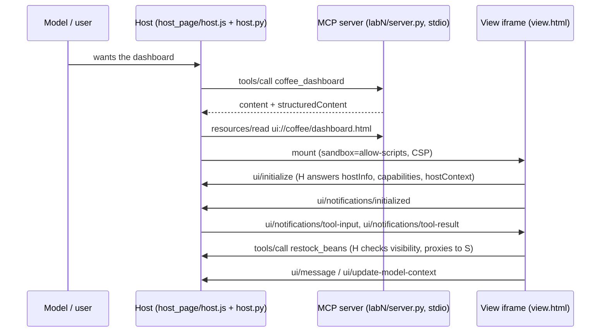

# Part 5 - MCP Apps: UI inside a host you do not control

**MCP Apps** (the MCP extension SEP-1865, `@modelcontextprotocol/ext-apps`) lets an MCP *server* ship an interactive UI that a *host* - Claude, ChatGPT, VS Code, Goose, or any MCP Apps-capable client - renders inside the conversation. It adds three things to a normal MCP server:

1. a **resource** with a `ui://` URI and MIME type `text/html;profile=mcp-app` (the *view*, one self-contained HTML document, with `_meta.ui.csp` declaring what network access it needs - here: none);
2. a **tool** whose `_meta.ui.resourceUri` points at that view, and `_meta.ui.visibility` (`["model","app"]` or app-only `["app"]`);
3. a **tool result** with `content` (text for the model and for hosts without UI) **and** `structuredContent` (data for the view).

The host mounts the view in a sandboxed iframe and runs a **JSON-RPC 2.0 bridge over postMessage**:



| Lab | Mode | Tool → view | Interaction |
|---|---|---|---|
| [lab1_static](lab1_static/) | static | data → a **pre-built** dashboard view | view calls `coffee_dashboard(days=3)` and app-only `restock_beans`; `ui/message` |
| [lab2_declarative](lab2_declarative/) | declarative | a **catalog spec** (server-side model, validated) → generic renderer view | app-only `ui_action` returns JSON Patch for the spec |
| [lab3_open_ended](lab3_open_ended/) | open-ended | **model-written HTML** → mounted one sandbox deeper | widget → view → `ui/update-model-context` |
| [lab4_mixed](lab4_mixed/) | mixed | catalog spec + `GeneratedView` | two app-only tools, model context, and a **text-only host** fallback |

**Shared pieces** ([`shared/`](shared/)): `host.py` (an MCP client over stdio using the official Python SDK `mcp` v2, plus the host's HTTP routes and visibility enforcement), `host_page/host.js` (iframe mounting, CSP from `_meta.ui.csp`, the bridge), `view-bridge.js` (the view side, same method names as the official `App` class: `callServerTool`, `sendMessage`, `updateModelContext`, `ontoolresult`), `view-kit.js` (the course's components bundled for views), `text_host.py` (a host without UI), and `conformance.mjs`, which checks **every recorded bridge message against the official `@modelcontextprotocol/ext-apps` zod schemas** (each demo writes `bridge_log.json`; all labs pass).

## Use the servers in a real host

Each `server.py` is a normal MCP server over stdio. For Claude Desktop add, for example, to `claude_desktop_config.json`:

```json
{"mcpServers": {"coffee-cart": {"command": "python", "args": ["/ABSOLUTE/PATH/05_mcp_apps/lab4_mixed/server.py"]}}}
```

Hosts that support MCP Apps render the view; hosts that do not show `content` (see lab 4's text host). Rendering in third-party hosts was **not** recorded here (no such host in the build environment); the browser host in this repo implements the same protocol and its traffic is validated against the official schemas.

Video script: [docs/video-scripts/part5_mcp_apps.md](../docs/video-scripts/part5_mcp_apps.md).
