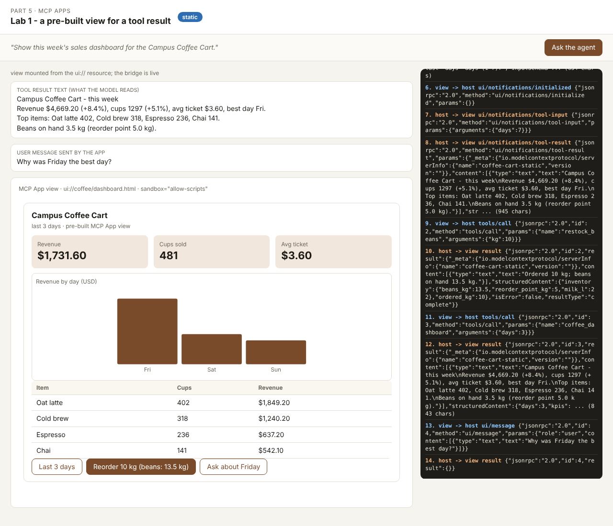

# Part 5 · Lab 1 - MCP Apps, static mode: a pre-built view for a tool result

**What this lab adds:** the smallest complete MCP App. The server has a tool `coffee_dashboard(days)` whose `_meta.ui.resourceUri` points at a pre-built HTML view, plus an **app-only** tool `restock_beans(kg)` the model cannot call. Our host calls the tool, reads the `ui://` resource, mounts it in a sandboxed iframe, and runs the JSON-RPC bridge. The view renders `structuredContent`, calls server tools *through the host*, and posts a chat message with `ui/message`.

## Run it

```bash
cd 05_mcp_apps/lab1_static
python run_host.py            # browser host on http://127.0.0.1:8051 (starts server.py over stdio)
python demo.py                # recorded run + bridge_log.json + official schema check
python -m pytest test_lab.py
```

## Recorded run

<!-- demo-output:start -->
```text
$ python demo.py
========================================================================
Part 5 / Lab 5.1 - MCP Apps static: a pre-built view for a tool result
========================================================================
tool coffee_dashboard  _meta.ui = {"resourceUri":"ui://coffee/dashboard.html","visibility":["model","app"]}
tool restock_beans     _meta.ui = {"resourceUri":"ui://coffee/dashboard.html","visibility":["app"]}
resources/read ui://coffee/dashboard.html: mimeType=text/html;profile=mcp-app, 20,249 bytes, _meta={"ui":{"csp":{"connectDomains":[],"resourceDomains":[]},"prefersBorder":true}}
structuredContent keys (for the view): ['days', 'inventory', 'items', 'kpis', 'labels', 'revenue']
content[0].text (for the model / UI-less hosts): Revenue $4,669.20 (+8.4%), cups 1297 (+5.1%), avg ticket $3.60, best day Fri.
model calls the app-only tool -> {"error": "tool 'restock_beans' is not visible to the model"}
screenshot: screenshot.png
bridge messages: view:ui/initialize, host:result, view:ui/notifications/initialized, host:ui/notifications/tool-input, host:ui/notifications/tool-result, view:tools/call, host:result, view:tools/call, host:result, view:ui/message, host:result
@modelcontextprotocol/ext-apps schemas: 8 messages checked, errors=[]
```
<!-- demo-output:end -->



## Code walkthrough

**Step 1 - a tool that points at a UI resource.** `visibility` decides who may call it.

`server.py`:
```python
@server.tool(meta=ui_meta(VIEW_URI, ["model", "app"]))
def coffee_dashboard(days: int = 7) -> types.CallToolResult:
    """Sales dashboard for the Campus Coffee Cart over the last `days` days (1-7)."""
    return result(scenario.as_text(), dashboard_data(days))
```

**Step 2 - text for the model, data for the view.**

`../shared/mcpapps.py`:
```python
def result(text: str, data: dict) -> types.CallToolResult:
    """content for the model (and UI-less hosts), structuredContent for the view."""
    return types.CallToolResult(content=[types.TextContent(type="text", text=text)], structured_content=data)
```

**Step 3 - the view as a resource**, MIME `text/html;profile=mcp-app`, with a CSP declaration (no network).

`server.py`:
```python
@server.resource(VIEW_URI, name="coffee_dashboard_view", mime_type=MIME, meta=VIEW_META)
def dashboard_view() -> str:
```

**Step 4 - the host mounts it and answers `ui/initialize`.**

`../shared/host_page/host.js`:
```js
      case "ui/initialize":
        return reply(m.id, {
          protocolVersion: "2026-01-26",
          hostInfo: { name: "genux-course-host", version: "1.0.0" },
```

**Step 5 - after `initialized`, the host hands the view the tool input and result.**

`../shared/host_page/host.js`:
```js
      case "ui/notifications/initialized":                // now the view is listening: hand it the call
        send({ jsonrpc: "2.0", method: "ui/notifications/tool-input", params: { arguments: args } });
        return send({ jsonrpc: "2.0", method: "ui/notifications/tool-result", params: result });
```

**Step 6 - the view calls server tools through the host**; the host enforces `visibility`.

`view.html`:
```js
    async function restock() {                // an app-only tool: invisible to the model
      const r = await app.callServerTool("restock_beans", { kg: 10 });
```

`../shared/host.py`:
```python
        if t is None or caller not in visibility(t):     # the host enforces _meta.ui.visibility
            return {"error": f"tool {body['name']!r} is not visible to the {caller}"}
```

## What to notice

- The view never talks to the server directly; every call goes view → host → server, and the host can refuse.
- The view has no network access at all (`connectDomains: []`); everything it needs arrives over the bridge.
- `demo.py` validates the recorded bridge traffic against `@modelcontextprotocol/ext-apps`' own schemas (`errors=[]`).

## Tests (`test_lab.py`)

Tool metadata and app-only visibility; the resource is a self-contained `text/html;profile=mcp-app` document with an empty CSP allow-list; the result has text and data; the recorded bridge traffic matches the official schemas.
