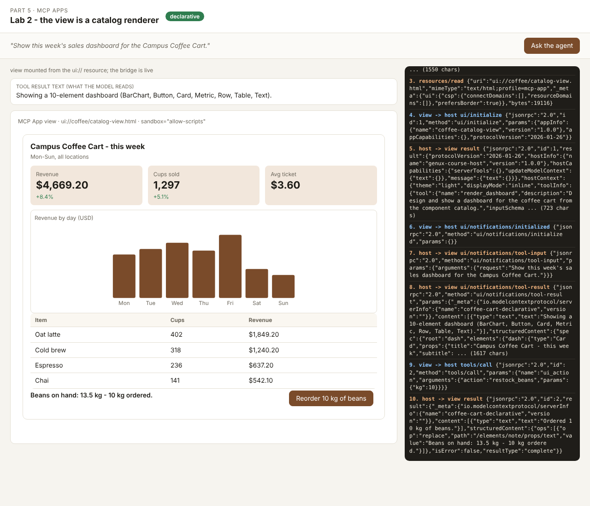

# Part 5 · Lab 2 - MCP Apps, declarative mode: the view is a catalog renderer

**What this lab adds:** the view stops hard-coding a dashboard and becomes a **generic renderer** for the course's component catalog. The tool `render_dashboard(request)` asks the server's own model for a flat element map, validates it against the catalog (invalid layouts return `isError: true` so the model can retry), and returns it as `structuredContent.spec`. Button presses go to an app-only tool, `ui_action`, which answers with JSON Patch operations for the spec.

## Run it

```bash
cd 05_mcp_apps/lab2_declarative
python run_host.py            # http://127.0.0.1:8052
python demo.py
python -m pytest test_lab.py
```

## Recorded run

<!-- demo-output:start -->
```text
$ python demo.py
========================================================================
Part 5 / Lab 5.2 - MCP Apps declarative: the view renders a catalog spec
========================================================================
content[0].text: Showing a 10-element dashboard (BarChart, Button, Card, Metric, Row, Table, Text).
structuredContent.spec: dash:Card, kpis:Row, m-rev:Metric, m-cups:Metric, m-ticket:Metric, chart:BarChart, items:Table, actions:Row, note:Text, restock:Button
app-only ui_action from the model -> {"error": "tool 'ui_action' is not visible to the model"}
app-only ui_action from the app   -> {"ops":[{"op":"replace","path":"/elements/note/props/text","value":"Beans on hand: 13.5 kg - 10 kg ordered."}]}
screenshot: screenshot.png
@modelcontextprotocol/ext-apps schemas: 6 bridge messages checked, errors=[]
```
<!-- demo-output:end -->



## Code walkthrough

**Step 1 - generate and validate on the server**; the model key never reaches the host or the view.

`server.py`:
```python
    spec = parse_json_reply(llm.text(system=SYSTEM, user=request, fixture="dashboard_spec"))
    errors = validate_spec(spec, actions=set(ACTIONS))
    if errors:  # isError results reach the model as text, so it can retry with another request
```

**Step 2 - an app-only tool for UI actions**, returning patches rather than a whole new spec.

`server.py`:
```python
@server.tool(meta=ui_meta(VIEW_URI, ["app"]))
def ui_action(action: str, params: dict | None = None) -> types.CallToolResult:
```

**Step 3 - the view: render whatever spec arrives; route Buttons to `ui_action`.**

`view.html`:
```js
      onAction: async (action, params) => {               // Button -> app-only server tool -> JSON Patch
        const r = await app.callServerTool("ui_action", { action, params });
        spec = applyPatch(spec, r.structuredContent.ops);
```

**Step 4 - one renderer, everywhere.** The view uses the same `renderSpec` as the AG-UI and harness labs, bundled into `view-kit.js` because a view must be self-contained.

`../shared/view-kit-entry.js`:
```js
export { h, components, renderSpec } from "../../common/web/ui.js";
```

## What to notice

- The view contains no dashboard data or layout (`test_view_is_generic_it_contains_no_dashboard_data`): one view can show any catalog UI the server decides on.
- Compare with AG-UI lab 2: the same spec shape; AG-UI streamed it as state into *your* page, MCP Apps hands it to a view inside *someone else's* host.

## Tests (`test_lab.py`)

The tool returns a valid catalog spec; `ui_action` returns patches and rejects unknown actions; the view is generic; the recorded bridge traffic matches the official schemas.
