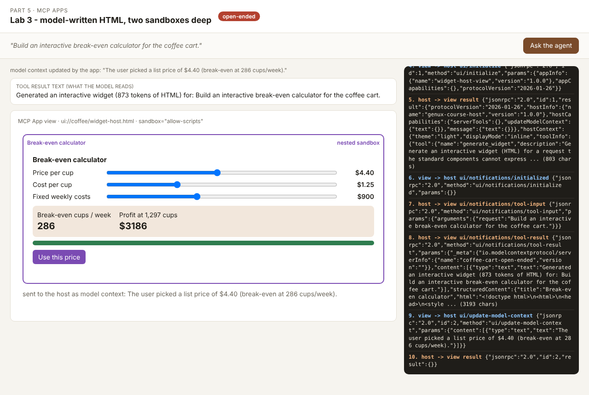

# Part 5 · Lab 3 - MCP Apps, open-ended mode: generated HTML, two sandboxes deep

**What this lab adds:** `generate_widget(request)` asks the server's model for a complete HTML widget, checks it against the HTML policy, and returns it in `structuredContent.html`. The view mounts it in a **nested** sandboxed iframe with its own CSP: host page → MCP App view (`sandbox="allow-scripts"`, CSP from `_meta.ui.csp`) → generated widget (`sandbox="allow-scripts"`, CSP injected first). The widget can only `genux.emit` to the view, and the view decides what reaches the host: here a `ui/update-model-context` so the model knows the user's choice on its next turn.

## Run it

```bash
cd 05_mcp_apps/lab3_open_ended
python run_host.py            # http://127.0.0.1:8053
python demo.py
python -m pytest test_lab.py
```

## Recorded run

<!-- demo-output:start -->
```text
$ python demo.py
========================================================================
Part 5 / Lab 5.3 - MCP Apps open-ended: generated HTML, two sandboxes deep
========================================================================
content[0].text: Generated an interactive widget (873 tokens of HTML) for: break-even calculator
structuredContent: title='Break-even calculator', html=2581 chars, allowedEvents=['apply_price']
view resource _meta.ui.csp: {'connectDomains': [], 'resourceDomains': []} (no network for the view)
nesting: host page > view iframe > widget iframe; frames on the page: 3
host status: model context updated by the app: "The user picked a list price of $4.40 (break-even at 286 cups/week)."
what the model will see next turn (host state): The user picked a list price of $4.40 (break-even at 286 cups/week).
screenshot: screenshot.png
@modelcontextprotocol/ext-apps schemas: 9 bridge messages checked, errors=[]
```
<!-- demo-output:end -->



## Code walkthrough

**Step 1 - generation and policy on the server.**

`server.py`:
```python
    html = strip_fences(llm.text(system=SYSTEM, user=request, fixture="break_even"))
    problems = check_html(html)
```

**Step 2 - the view mounts the HTML one sandbox deeper** and accepts only the allowed event.

`view.html`:
```js
      mountSandboxed(box, html, {
        allowed: allowedEvents,
```

**Step 3 - the view, not the widget, talks to the host.**

`view.html`:
```js
          await app.updateModelContext(text);
```

**Step 4 - the host stores what the model will see next.**

`../shared/host.py`:
```python
    @app.post("/host/context")
    def context(req):                                    # ui/update-model-context: what the model will see next turn
```

## What to notice

- Two trust boundaries: the host trusts the view only as far as the bridge allows; the view trusts the widget only as far as `allowedEvents` allows.
- `ui/update-model-context` does not start a turn; it changes what the model knows when the user next speaks (compare `ui/message`, used in lab 1, which posts a message).
- The demo counts three frames on the page: host page, view, widget.

## Tests (`test_lab.py`)

The widget is generated server-side and passes the policy; the view mounts it in its own sandbox; the recorded bridge traffic (including `ui/update-model-context`) matches the official schemas.
