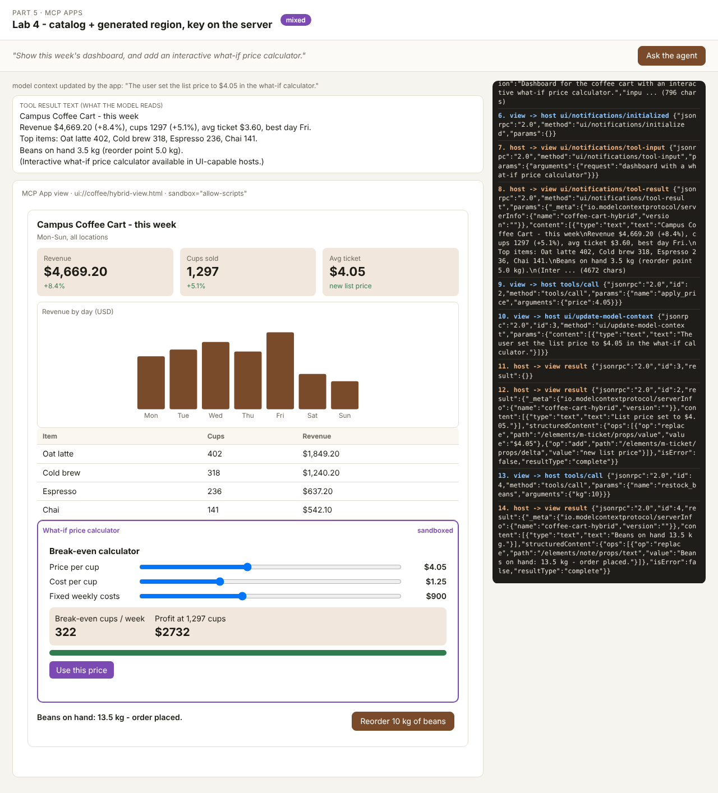

# Part 5 · Lab 4 - MCP Apps, mixed mode: catalog + generated region, two hosts

**What this lab adds:** the hybrid inside an MCP App, plus the rule every MCP App must follow: **ship both**. `coffee_dashboard_hybrid` returns a catalog spec with one `GeneratedView` (HTML written by the server's model). The view renders the catalog and mounts the region in a nested sandbox. Interaction uses two **app-only** tools - `restock_beans` from the catalog Button and `apply_price` from the generated region (validated as untrusted input) - both answering with JSON Patch. The same server is also used by a **text-only host** that ignores `_meta.ui` and shows `content`, which is a complete answer on its own.

## Run it

```bash
cd 05_mcp_apps/lab4_mixed
python run_host.py            # http://127.0.0.1:8054
python ../shared/text_host.py server.py coffee_dashboard_hybrid '{"request": "dashboard"}'
python demo.py
python -m pytest test_lab.py
```

## Recorded run

<!-- demo-output:start -->
```text
$ python demo.py
========================================================================
Part 5 / Lab 5.4 - MCP Apps mixed: catalog + generated region, two hosts
========================================================================
[text host] tools offered to the model: coffee_dashboard_hybrid
[text host] coffee_dashboard_hybrid -> (UI resource ignored, showing content[])
    Campus Coffee Cart - this week
    Revenue $4,669.20 (+8.4%), cups 1297 (+5.1%), avg ticket $3.60, best day Fri.
    Top items: Oat latte 402, Cold brew 318, Espresso 236, Chai 141.
    Beans on hand 3.5 kg (reorder point 5.0 kg).
    (Interactive what-if price calculator available in UI-capable hosts.)
[web host] model -> apply_price(4.0): tool 'apply_price' is not visible to the model
[web host]   app -> apply_price(40): price 40.0 is outside 2-7 USD
[web host] after both tool calls the nested calculator still shows $4.05
[web host] model context updated by the app: "The user set the list price to $4.05 in the what-if calculator."
screenshot: screenshot.png
[web host] view -> host tools/call: ['apply_price', 'restock_beans']
@modelcontextprotocol/ext-apps schemas: 9 bridge messages checked, errors=[]
```
<!-- demo-output:end -->



## Code walkthrough

**Step 1 - hybrid validation on the server**: catalog + at most one GeneratedView + HTML policy.

`server.py`:
```python
    errors = validate_spec(spec, hybrid=True, actions=set(ACTIONS))
    views = [el for el in spec["elements"].values() if el["type"] == "GeneratedView"]
```

**Step 2 - `content` is a full answer for hosts without UI.**

`server.py`:
```python
    return result(scenario.as_text() + "\n(Interactive what-if price calculator available in UI-capable hosts.)", {"spec": spec})
```

**Step 3 - app-only tools validate input from the generated region.**

`server.py`:
```python
@server.tool(meta=ui_meta(VIEW_URI, ["app"]))
def apply_price(price: float) -> types.CallToolResult:
    """App-only: the generated calculator proposes a new list price. Untrusted input: validated."""
```

**Step 4 - the view patches only what changed**, so the nested calculator keeps its state.

`view.html`:
```js
      for (const id of new Set(r.structuredContent.ops.map((op) => op.path.split("/")[2]))) {
```

**Step 5 - the text-only host.**

`../shared/text_host.py`:
```python
    lines += ["    " + l for block in res["content"] if block["type"] == "text" for l in block["text"].splitlines()]
```

## What to notice

- The text host only lists the model-visible tool; app-only tools are invisible to it, as they are to the model.
- The host refuses `apply_price` from the model; the server refuses `apply_price(40)` from the app. Two independent checks.
- Compare with AG-UI lab 4: the same hybrid, but the UI lives in a host the server does not control, and every interaction crosses the bridge.

## Tests (`test_lab.py`)

Valid hybrid spec with one GeneratedView; interaction tools are app-only and validate input; the text-only host gets a useful answer; the recorded bridge traffic matches the official schemas.
