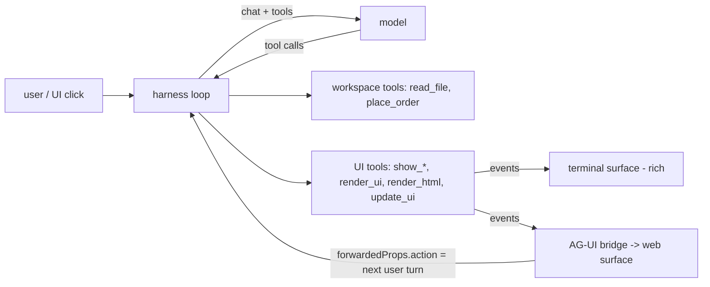

# Part 6 - Harness integration: generative UI inside a coding-agent loop

Parts 1-5 looked at protocols and formats. This part puts generative UI where agents actually run: inside a **harness** - the tool-calling loop of a coding agent (Claude Code, Codex, the course's `simple-coding-harness`). The loop in [`shared/harness.py`](shared/harness.py) is the classic one:

```text
messages = [system, user]
repeat: reply = model(messages, tools)
        no tool calls?  -> done
        else run each tool, append its result as a "tool" message
```

Generative UI joins it **as tools**. A UI tool computes nothing: it validates a description of an interface and hands it to the **surfaces** listening to the loop's events. Its result goes back to the model like any other tool result - including validation errors, which is how the agent corrects its own UI.



| Lab | Mode | UI tools | What the loop shows |
|---|---|---|---|
| [lab1_static](lab1_static/) | static | `show_metric`, `show_chart`, `show_table` | read the CSVs, then call pre-built UI tools; **two surfaces** for one run |
| [lab2_declarative](lab2_declarative/) | declarative | `render_ui(spec)` validated against the catalog | the first spec is rejected; the **loop self-corrects** |
| [lab3_open_ended](lab3_open_ended/) | open-ended | `render_html(title, html)` | policy check, **artifact file** with CSP, sandboxed web view |
| [lab4_mixed](lab4_mixed/) | mixed | `render_ui` (hybrid) + `update_ui(ops)` + `place_order` | **UI clicks become the next user turn**; the agent edits the workspace and patches the UI |

**Shared pieces:** `harness.py` (loop, events, a sandboxed workspace copy of [`workspace_template/`](shared/workspace_template/)), `surfaces.py` (`TerminalSurface` with `rich`; `AguiSurface` + `stream_run` bridging harness events to AG-UI using the official `ag-ui-protocol` encoder), `web.py` (the HTTP app: `POST /agui`, allow-listed UI actions), `web/harness.js` (the AG-UI page).

Every agent runs two ways: `python agent.py` (terminal) and `python agent.py --web` (browser). Lab 4 is web-first because its point is the human clicking.

Video script: [docs/video-scripts/part6_harness.md](../docs/video-scripts/part6_harness.md).
