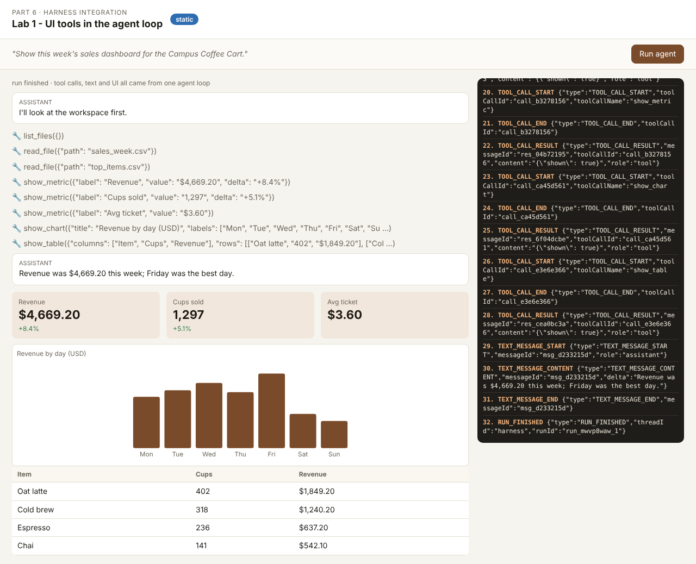

# Part 6 · Lab 1 - Harness, static mode: UI tools next to file tools, two surfaces

**What this lab adds:** generative UI inside an agent loop. The harness has ordinary workspace tools (`list_files`, `read_file`) and three pre-built UI tools (`show_metric`, `show_chart`, `show_table`). The agent reads the CSV exports in its workspace, then *calls UI tools* to show the numbers. One run, two surfaces: the terminal draws the UI tool calls with `rich`; the browser receives the same run as AG-UI events and draws them with its own components.

## Run it

```bash
cd 06_harness/lab1_static
python agent.py               # terminal surface
python agent.py --web         # web surface on http://127.0.0.1:8061
python demo.py
python -m pytest test_lab.py
```

## Recorded run

<!-- demo-output:start -->
```text
$ python demo.py
========================================================================
Part 6 / Lab 6.1 - harness static: UI tools next to file tools, two surfaces
========================================================================
--- surface 1: terminal
> Show this week's sales dashboard for the Campus Coffee Cart.
assistant: I'll look at the workspace first.
  tool list_files({})
  tool read_file({"path": "sales_week.csv"})
  tool read_file({"path": "top_items.csv"})
  tool show_metric({"label": "Revenue", "value": "$4,669.20", "delta": "+8.4%"})
┌─────── Revenue ────────┐
│ $4,669.20  +8.4%       │
└────────────────────────┘
  tool show_metric({"label": "Cups sold", "value": "1,297", "delta": "+5.1%"})
┌────── Cups sold ───────┐
│ 1,297  +5.1%           │
└────────────────────────┘
  tool show_metric({"label": "Avg ticket", "value": "$3.60"})
   ... (chart and table panels) ...
assistant: Revenue was $4,669.20 this week; Friday was the best day.
--- surface 2: the same run bridged to AG-UI
events: {'RUN_STARTED': 1, 'TEXT_MESSAGE_START': 2, 'TEXT_MESSAGE_CONTENT': 2, 'TEXT_MESSAGE_END': 2, 'TOOL_CALL_START': 8, 'TOOL_CALL_ARGS': 8, 'TOOL_CALL_END': 8, 'TOOL_CALL_RESULT': 8, 'RUN_FINISHED': 1}
tool calls in order: ['list_files', 'read_file', 'read_file', 'show_metric', 'show_metric', 'show_metric', 'show_chart', 'show_table']
screenshot: screenshot.png
```
<!-- demo-output:end -->



## Code walkthrough

**Step 1 - the loop.** Tool results, UI or not, go back into the conversation.

`../shared/harness.py`:
```python
        for _ in range(self.max_turns):
            reply = self.llm.chat(messages=self.messages, tools=[t.schema() for t in self.tools], fixture=self.fixture)
...
                if tool and tool.ui and ok:
                    self.emit("ui", tool=call["name"], arguments=call["arguments"], result=out)
```

**Step 2 - a UI tool computes nothing.** It acknowledges; the surfaces draw its arguments.

`agent.py`:
```python
def shown(**props):
    """A UI tool computes nothing: it acknowledges, and the surfaces draw the arguments."""
    return {"shown": True}
```

**Step 3 - UI tools sit next to workspace tools.**

`agent.py`:
```python
    return Harness(llm=get_llm(HERE / "fixtures"), system=SYSTEM, tools=Workspace().tools() + UI_TOOLS, fixture="session")
```

**Step 4 - surface 1: the terminal registry.**

`../shared/surfaces.py`:
```python
    STATIC = {"show_metric": "Metric", "show_chart": "BarChart", "show_table": "Table"}
```

**Step 5 - surface 2: every harness event becomes AG-UI events.**

`../shared/surfaces.py`:
```python
        elif kind == "tool_call":
            self.put(ToolCallStartEvent(type=EventType.TOOL_CALL_START, tool_call_id=d["id"], tool_call_name=d["name"]))
```

**Step 6 - the run streams while it happens** (the harness runs in a thread, the HTTP handler drains the queue).

`../shared/surfaces.py`:
```python
    while (event := surface.q.get()) is not None:
        yield encoder.encode(event)
```

## What to notice

- The model decided to read the data *before* showing it - generative UI is just another kind of tool use for a harness.
- One agent, two renderers, zero duplication: the terminal and the page subscribe to the same events.
- Compare with Part 1 lab 1: the same AG-UI tool-call stream, now produced by a real loop instead of one model call.

## Tests (`test_lab.py`)

The loop reads files, then calls UI tools, then answers; `read_file` results are in the conversation; the workspace cannot be escaped; the terminal draws the UI; the web surface bridges the whole run to AG-UI (8 `TOOL_CALL_RESULT`s).
