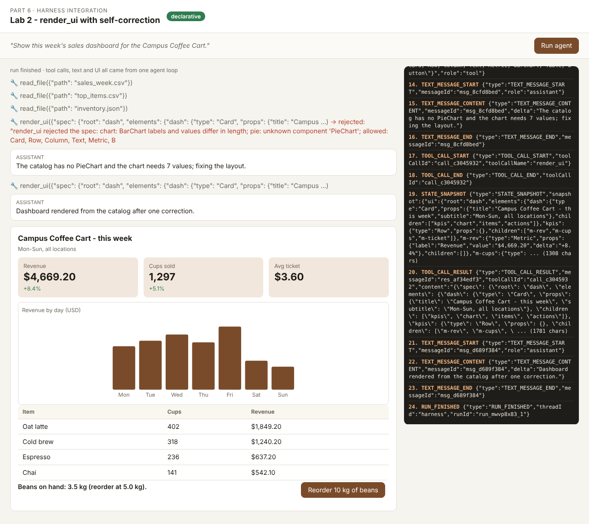

# Part 6 · Lab 2 - Harness, declarative mode: `render_ui` with self-correction

**What this lab adds:** one declarative UI tool, `render_ui(spec)`, whose argument is a flat element map from the course catalog. The tool **validates** the spec. An invalid spec is returned to the model as an ordinary tool error, and the agent loop does the rest: the model reads the error and calls `render_ui` again. The scripted first attempt uses a `PieChart` (not in the catalog) and a chart with 7 labels but 5 values; only the corrected spec ever reaches a surface.

## Run it

```bash
cd 06_harness/lab2_declarative
python agent.py               # terminal
python agent.py --web         # http://127.0.0.1:8062
python demo.py
python -m pytest test_lab.py
```

## Recorded run

<!-- demo-output:start -->
```text
$ python demo.py
========================================================================
Part 6 / Lab 6.2 - harness declarative: render_ui validated, the loop self-corrects
========================================================================
--- surface 1: terminal
> Show this week's sales dashboard for the Campus Coffee Cart.
  tool read_file({"path": "sales_week.csv"})
  tool read_file({"path": "top_items.csv"})
  tool read_file({"path": "inventory.json"})
  tool render_ui({"spec": {"root": "dash", "elements": {"dash": {"type": "Card", "props...)
  ! render_ui failed: {"error": "render_ui rejected the spec: chart: BarChart labels and values 
differ in length; pie: unknown component 'PieChart'; allowed: Card, Row, Col
assistant: The catalog has no PieChart and the chart needs 7 values; fixing the layout.
  tool render_ui({"spec": {"root": "dash", "elements": {"dash": {"type": "Card", "props...)
   ... (the dashboard, drawn with rich) ...
assistant: Dashboard rendered from the catalog after one correction.
tool result the model received after attempt 1:
    render_ui rejected the spec: chart: BarChart labels and values differ in length
    pie: unknown component 'PieChart'
    allowed: Card, Row, Column, Text, Metric, BarChart, Table, Button
--- surface 2: AG-UI: ['read_file', 'read_file', 'read_file', 'render_ui', 'render_ui'] -> 1 STATE_SNAPSHOT (only the valid spec reaches the page)
screenshot: screenshot.png
```
<!-- demo-output:end -->



## Code walkthrough

**Step 1 - the tool validates, and writes errors for the model to act on.**

`agent.py`:
```python
def render_ui(spec: dict) -> dict:
    """The UI tool: validate first; the error text is written for the model to act on."""
    errors = validate_spec(spec, actions=set(ACTIONS))
    if errors:
        return {"error": "render_ui rejected the spec: " + "; ".join(errors)}
```

**Step 2 - the loop treats a failed tool as a result, not a crash**, and only successful UI calls reach the surfaces.

`../shared/harness.py`:
```python
                ok = not (isinstance(out, dict) and "error" in out)
                if tool and tool.ui and ok:
```

**Step 3 - the system prompt carries the catalog** (generated from `common/catalog.py`).

`agent.py`:
```python
          "dashboard built from this catalog. If render_ui returns errors, fix them and call it again.\n"
          + catalog_prompt(actions=ACTIONS).split("\n", 1)[1])
```

**Step 4 - on the web, a valid spec becomes AG-UI state.**

`../shared/surfaces.py`:
```python
        if "spec" in r:
            self.state = {"ui": r["spec"]}
            self.put(StateSnapshotEvent(type=EventType.STATE_SNAPSHOT, snapshot=self.state))
```

## What to notice

- No retry code anywhere: self-correction is a property of the loop plus good error messages.
- The page shows the rejected call in the transcript (red) but never renders it - compare A2UI lab 2, where the server ran the correction loop itself.

## Tests (`test_lab.py`)

An invalid spec is a tool error with actionable text; the loop retries and only the second spec is shown; only the valid spec reaches the web page.
