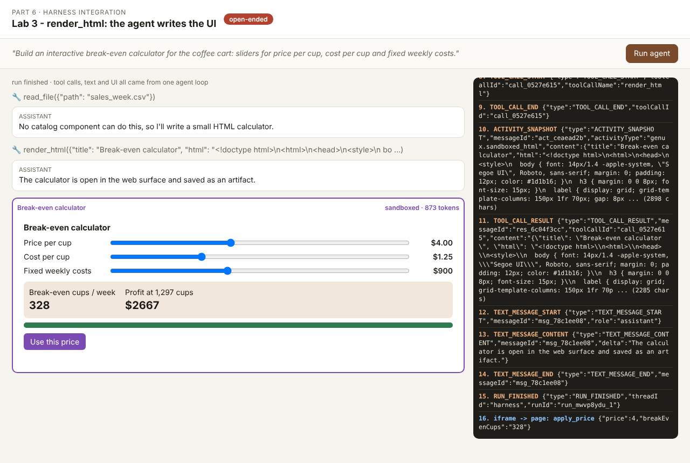

# Part 6 · Lab 3 - Harness, open-ended mode: the agent writes the UI with `render_html`

**What this lab adds:** a coding agent's natural escape hatch - it writes the interface itself. `render_html(title, html)` (1) checks the document against the HTML policy (a violation is a tool error the model can fix), (2) saves it as an **artifact** with the CSP injected first in `<head>` (`artifacts/break-even-calculator.html`), and (3) hands it to the surfaces: the web surface mounts it in a sandboxed iframe via AG-UI `ACTIVITY_SNAPSHOT`; the terminal prints where the file is.

## Run it

```bash
cd 06_harness/lab3_open_ended
python agent.py               # terminal: prints the artifact path
python agent.py --web         # http://127.0.0.1:8063
python demo.py
python -m pytest test_lab.py
```

## Recorded run

<!-- demo-output:start -->
```text
$ python demo.py
========================================================================
Part 6 / Lab 6.3 - harness open-ended: the agent writes the UI with render_html
========================================================================
--- surface 1: terminal
> Build an interactive break-even calculator for the coffee cart: sliders for price per cup, 
cost per cup and fixed weekly costs.
  tool read_file({"path": "sales_week.csv"})
assistant: No catalog component can do this, so I'll write a small HTML calculator.
  tool render_html({"title": "Break-even calculator", "html": "<!doctype html>\n<html>\n<...)
╔════════════════════════════════════════ render_html ═════════════════════════════════════════╗
║ Break-even calculator: saved to artifacts/break-even-calculator.html (873 tokens)            ║
║ open it in a browser, or use the web surface (--web)                                         ║
╚══════════════════════════════════════════════════════════════════════════════════════════════╝
assistant: The calculator is open in the web surface and saved as an artifact.
artifact starts with: <head><meta http-equiv="Content-Security-Policy" content="default-src 'none'; script-src 'unsaf ...
policy check of a bad document: render_html rejected the document: external <script src> is not allowed; remote resources are not allowed
--- surface 2: AG-UI ACTIVITY_SNAPSHOT: {"title":"Break-even calculator","tokens":873}
screenshot: screenshot.png
```
<!-- demo-output:end -->



## Code walkthrough

**Step 1 - policy first; a violation goes back to the model.**

`agent.py`:
```python
    problems = check_html(html)
    if problems:
        return {"error": "render_html rejected the document: " + "; ".join(problems)}
```

**Step 2 - the saved artifact carries its own CSP**, so opening the file later is as restricted as the sandbox.

`agent.py`:
```python
    path.write_text(with_csp(html), encoding="utf-8")      # the saved copy carries its own CSP
```

**Step 3 - the terminal cannot run HTML, so it points at the artifact.**

`../shared/surfaces.py`:
```python
            return Panel(f"{d['result']['title']}: saved to {d['result']['path']} ({d['result']['tokens']} tokens)\n"
```

**Step 4 - the web surface receives an activity and sandboxes it.**

`../shared/web/harness.js`:
```js
    case "ACTIVITY_SNAPSHOT": {                                                                         // render_html
```

## What to notice

- The open-ended output survives both surfaces only partially: fully interactive in the browser, a file path in the terminal. That asymmetry is the price of open-ended UI.
- Token cost is visible in the tool result (`tokens`), so a harness can budget it like any other tool output.

## Tests (`test_lab.py`)

The artifact is saved with the CSP before any other head element; policy violations are tool errors; the web surface receives the document as an `ACTIVITY_SNAPSHOT`.
