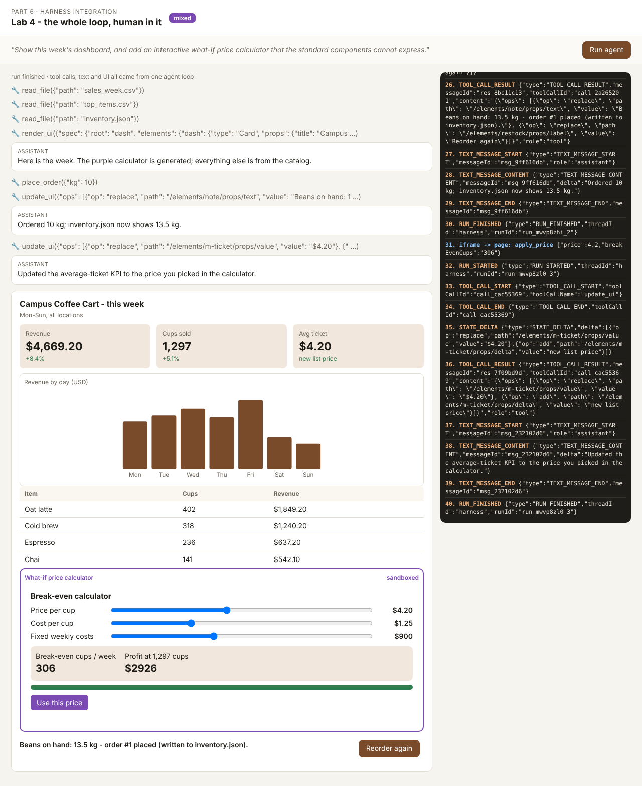

# Part 6 · Lab 4 - Harness, mixed mode: the whole loop, with the human in it

**What this lab adds:** everything together, and the step that makes generative UI *conversational*. The agent reads its workspace and calls `render_ui` with a **hybrid** spec (catalog + one `GeneratedView`, HTML-policy checked). When the user clicks - the catalog "Reorder" Button or "Use this price" inside the sandboxed calculator - the web surface sends the click as `forwardedProps.action`, and the harness turns it into **the next user turn of the same conversation**: `[ui action] restock_beans {"kg": 10}`. The agent then acts with real tools (`place_order` edits `inventory.json` in its workspace) and patches the screen with `update_ui(ops)`, which re-validates the patched spec before it is shown (AG-UI `STATE_DELTA`).

## Run it

```bash
cd 06_harness/lab4_mixed
python agent.py               # web surface on http://127.0.0.1:8064
python demo.py                # three runs over HTTP + the same flow clicked in a browser
python -m pytest test_lab.py
```

## Recorded run

<!-- demo-output:start -->
```text
$ python demo.py
========================================================================
Part 6 / Lab 6.4 - harness mixed: the whole loop, with the human in it
========================================================================
run 'request': tools ['read_file', 'read_file', 'read_file', 'render_ui'], UI events ['STATE_SNAPSHOT']
run 'restock_beans': tools ['place_order', 'update_ui'], UI events ['STATE_DELTA']
    STATE_DELTA {"op":"replace","path":"/elements/note/props/text","value":"Beans on hand: 13.5 kg - order #1 placed (writt...
run 'apply_price': tools ['update_ui'], UI events ['STATE_DELTA']
    STATE_DELTA {"op":"replace","path":"/elements/m-ticket/props/value","value":"$4.20"}
the conversation now has 19 messages; user turns: ["Show this week's dashboard, and add an intera", '[ui action] restock_beans {"kg": 10}', '[ui action] apply_price {"price": 4.2}']
inventory.json in the agent's workspace: {'beans_kg': 13.5, 'reorder_point_kg': 5.0, 'milk_l': 22.0, 'orders': [{'id': 1, 'kg': 10.0}]}
refused action: {"error": "action 'rm_rf' not allowed"}
--- the terminal surface saw the same runs (last lines):
  (UI on screen patched: /elements/note/props/text, /elements/restock/props/label)
assistant: Ordered 10 kg; inventory.json now shows 13.5 kg.
> [ui action] apply_price {"price": 4.2}
  tool update_ui({"ops": [{"op": "replace", "path": "/elements/m-ticket/props/value", "...)
  (UI on screen patched: /elements/m-ticket/props/value, /elements/m-ticket/props/delta)
assistant: Updated the average-ticket KPI to the price you picked in the calculator.
screenshot: screenshot.png
```
<!-- demo-output:end -->



## Code walkthrough

**Step 1 - a click becomes a user turn** (only allow-listed actions).

`../shared/web.py`:
```python
        if fp.get("action"):
            if fp["action"] not in (actions or set()):     # the page may only send allowed actions
                return {"error": f"action {fp['action']!r} not allowed"}
            text = f"[ui action] {fp['action']} {json.dumps(fp.get('params') or {})}"
```

**Step 2 - the agent acts with a real tool**: the order is written to the workspace.

`agent.py`:
```python
    def place_order(self, kg: float) -> dict:
        kg = max(1.0, min(float(kg), 50.0))
        path = self.ws.path("inventory.json")
```

**Step 3 - `update_ui` patches the screen, but never into an invalid state.**

`agent.py`:
```python
        new = jsonpatch.apply(self.spec, ops)
        errors = validate_spec(new, hybrid=True, actions=set(ACTIONS))
        if errors:
            return {"error": "update_ui would break the UI: " + "; ".join(errors)}
```

**Step 4 - patches travel as AG-UI `STATE_DELTA`; the page re-renders only touched elements**, so the calculator keeps its state.

`../shared/web/harness.js`:
```js
function paintChanged(delta) {                    // keep sandboxed regions alive: patch only touched elements
```

## What to notice

- The conversation keeps growing across clicks (the demo prints 3 user turns, two of them clicks): the agent sees *why* the UI changed and can explain it.
- Clicks are requests, not commands: the agent chooses which tools to call, and the server refuses actions that are not allow-listed (`rm_rf`).
- This is the hybrid from Part 1 lab 4 again - same catalog, same sandbox, same AG-UI events - now driven by a general-purpose agent loop instead of hand-written handlers.

## Tests (`test_lab.py`)

UI actions become turns and the agent writes the workspace (`beans_kg == 13.5`); `update_ui` re-validates the patched spec; `render_ui` applies the HTML policy to the generated view; unknown page actions are refused.
